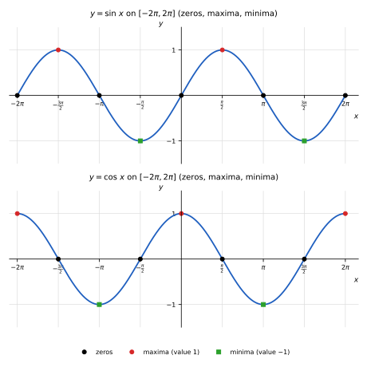
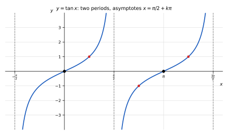
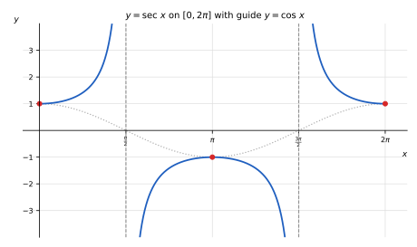
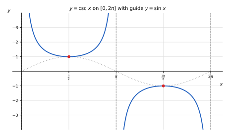
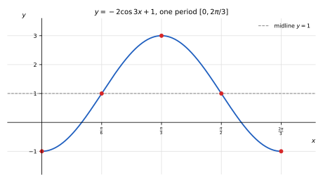
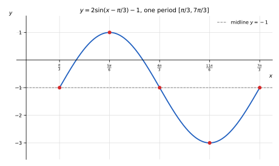
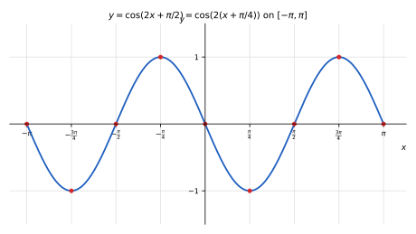
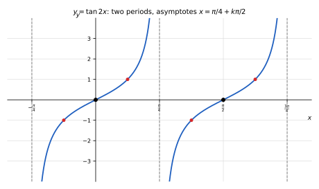

# Homework 6 Solutions

Based on [Lecture 6: Trigonometric Functions and Their Properties](../Notes/N6.md).

Angles without a degree symbol are in radians, and $k\in\mathbb Z$ means that
$k$ is any integer.

## Section 1: A $120^\circ$ Isosceles Triangle

**Exercise 1.** An isosceles triangle has equal sides of length $5$ and
vertex angle $120^\circ=2\pi/3$. Find the base length and altitude from
the vertex. Check the base length using the sine law.

**Solution.** The base angles are $(180^\circ-120^\circ)/2=30^\circ$. The
altitude from the vertex bisects the vertex angle and the base, so it creates a
$30^\circ$-$60^\circ$-$90^\circ$ triangle with hypotenuse $5$ and a $60^\circ$
angle at the vertex. Then
$$
\text{altitude}=5\cos60^\circ=\boxed{\frac52},\qquad
\frac{\text{base}}2=5\sin60^\circ=\frac{5\sqrt3}2,
\qquad\boxed{\text{base}=5\sqrt3}.
$$
Check by the sine law, pairing the base $a$ with $A=120^\circ$ and a side of
length $5$ with the opposite $30^\circ$ angle:
$$
\frac{a}{\sin120^\circ}=\frac{5}{\sin30^\circ}=\frac{5}{1/2}=10,
\qquad a=10\cdot\frac{\sqrt3}2=5\sqrt3.
$$
This agrees. (Also $(5/2)^2+(5\sqrt3/2)^2=25/4+75/4=25$.)

**Exercise 2.** Two sides of a triangle have lengths $3$ and $5$, and
their included angle is $120^\circ=2\pi/3$. Use the cosine law to find
the third side exactly.

**Solution.** With $\cos(2\pi/3)=-1/2$,
$$
c^2=3^2+5^2-2\cdot3\cdot5\cos\frac{2\pi}3
=9+25-30\left(-\frac12\right)=34+15=49.
$$
Therefore $\boxed{c=7}$.

**Exercise 3.** In triangle $ABC$, $A=120^\circ=2\pi/3$,
$B=45^\circ=\pi/4$, and the opposite side $a=4\sqrt3$. Find angle $C$
in degrees and radians, then use the sine law to find side $b$ exactly.

**Solution.** The angles sum to $180^\circ$, so
$$
C=180^\circ-120^\circ-45^\circ=\boxed{15^\circ=\frac{\pi}{12}}.
$$
By the sine law, $\dfrac{b}{\sin45^\circ}=\dfrac{a}{\sin120^\circ}$, so
$$
b=\frac{4\sqrt3\cdot\sin45^\circ}{\sin120^\circ}
=\frac{4\sqrt3\cdot\frac{\sqrt2}2}{\frac{\sqrt3}2}
=\boxed{4\sqrt2}.
$$
Check: $a/\sin A=4\sqrt3/(\sqrt3/2)=8$ and $b/\sin B=4\sqrt2/(\sqrt2/2)=8$.

**Exercise 4.** An isosceles triangle has side lengths $3$, $3$, and
$3\sqrt3$. Use the cosine law to find the cosine of its vertex angle,
then identify all three angles in degrees and radians.

**Solution.** The vertex angle $A$ is between the equal sides and opposite the
side $3\sqrt3$. The cosine law gives
$$
(3\sqrt3)^2=3^2+3^2-2\cdot3\cdot3\cos A,
\qquad 27=18-18\cos A,
$$
so $\cos A=(18-27)/18=\boxed{-\tfrac12}$. Since $0^\circ<A<180^\circ$, we get
$A=120^\circ=2\pi/3$. The base angles are equal, each
$(180^\circ-120^\circ)/2=30^\circ=\pi/6$. Thus the angles are
$$
\boxed{120^\circ=\tfrac{2\pi}3,\quad 30^\circ=\tfrac\pi6,\quad 30^\circ=\tfrac\pi6}.
$$
Check with Exercise 1's scaling: the sides $2,2,2\sqrt3$ of the lecture
triangle are multiplied by $3/2$.

## Section 2: Calculating $\sin72^\circ$ Exactly

**Exercise 5.** Let $d=(1+\sqrt5)/2$. Verify that $d^2=d+1$ and
$1/d=d-1$. Use the second identity to rewrite
$\cos(2\pi/5)=1/(2d)$ as $(\sqrt5-1)/4$.

**Solution.** First,
$$
d^2=\frac{(1+\sqrt5)^2}{4}=\frac{6+2\sqrt5}{4}=\frac{3+\sqrt5}2,
\qquad d+1=\frac{1+\sqrt5}2+1=\frac{3+\sqrt5}2,
$$
so $\boxed{d^2=d+1}$. Dividing $d^2=d+1$ by $d$ gives $d=1+1/d$, hence
$\boxed{1/d=d-1}$. Directly, $d-1=\dfrac{1+\sqrt5-2}{2}=\dfrac{\sqrt5-1}2$ and
$$
\frac1d=\frac{2}{1+\sqrt5}\cdot\frac{\sqrt5-1}{\sqrt5-1}
=\frac{2(\sqrt5-1)}{4}=\frac{\sqrt5-1}2,
$$
which agrees. Therefore
$$
\cos\frac{2\pi}5=\frac1{2d}=\frac12(d-1)=\frac12\cdot\frac{\sqrt5-1}{2}
=\boxed{\frac{\sqrt5-1}{4}}.
$$

**Exercise 6.** An isosceles triangle has vertex angle
$36^\circ=\pi/5$, base angles $72^\circ=2\pi/5$, and base length $4$.
Find its equal side lengths and its altitude exactly. Explain why changing
the scale does not change the cosine of a base angle.

**Solution.** Let the equal sides have length $L$. The altitude to the base
meets it at its midpoint, forming a right triangle with hypotenuse $L$ and
base angle $72^\circ$ adjacent to the leg $4/2=2$. Hence
$$
\cos72^\circ=\frac2L\quad\Longrightarrow\quad
L=\frac{2}{(\sqrt5-1)/4}=\frac{8}{\sqrt5-1}=\frac{8(\sqrt5+1)}{4}
=\boxed{2(1+\sqrt5)}.
$$
(This is $4d$, the lecture triangle scaled by $4$.) The altitude is
$$
h=\sqrt{L^2-2^2}=\sqrt{4(6+2\sqrt5)-4}=\sqrt{20+8\sqrt5}
=\boxed{2\sqrt{5+2\sqrt5}}\approx6.155.
$$
Check: $h=L\sin72^\circ=2(1+\sqrt5)\cdot\dfrac{\sqrt{10+2\sqrt5}}4$, and
squaring gives $\dfrac{(6+2\sqrt5)(10+2\sqrt5)}{4}=\dfrac{80+32\sqrt5}4
=20+8\sqrt5$.

Scaling by a factor $s>0$ multiplies every side by $s$, so the similar triangles
have equal side ratios. Since $\cos72^\circ=\dfrac{\text{adjacent}}{\text{hypotenuse}}$,
the factor $s$ cancels and the cosine is unchanged.

**Exercise 7.** Use the complementary-angle relations to find exact
values of $\sin18^\circ=\sin(\pi/10)$ and
$\cos18^\circ=\cos(\pi/10)$ from the values at $72^\circ=2\pi/5$.

**Solution.** Since $18^\circ=90^\circ-72^\circ$, i.e. $\pi/10=\pi/2-2\pi/5$,
$$
\sin\frac\pi{10}=\sin\left(\frac\pi2-\frac{2\pi}5\right)=\cos\frac{2\pi}5
=\boxed{\frac{\sqrt5-1}4}\approx0.3090,
$$
$$
\cos\frac\pi{10}=\cos\left(\frac\pi2-\frac{2\pi}5\right)=\sin\frac{2\pi}5
=\boxed{\frac{\sqrt{10+2\sqrt5}}4}\approx0.9511.
$$
Check: $\left(\frac{\sqrt5-1}4\right)^2+\frac{10+2\sqrt5}{16}
=\frac{6-2\sqrt5+10+2\sqrt5}{16}=1$.

**Exercise 8.** In the triangle $ACD$ from this section, use the sine
law to show that
$$
\sin\frac\pi5=\frac{\sin(2\pi/5)}{d}.
$$
Simplify this to an exact value for $\sin36^\circ=\sin(\pi/5)$, then
use the Pythagorean identity to find $\cos36^\circ=\cos(\pi/5)$.

**Solution.** In triangle $ACD$, side $CD=1$ is opposite $\angle A=\pi/5$, and
side $AC=d$ is opposite $\angle D=2\pi/5$. The sine law gives
$$
\frac{CD}{\sin(\pi/5)}=\frac{AC}{\sin(2\pi/5)}
\quad\Longrightarrow\quad
\frac{1}{\sin(\pi/5)}=\frac{d}{\sin(2\pi/5)},
$$
so $\sin(\pi/5)=\sin(2\pi/5)/d$. Using $1/d=(\sqrt5-1)/2$,
$$
\sin\frac\pi5=\frac{\sqrt{10+2\sqrt5}}4\cdot\frac{\sqrt5-1}2
=\frac{(\sqrt5-1)\sqrt{10+2\sqrt5}}{8}.
$$
To put this in simpler form, square it:
$$
\frac{(6-2\sqrt5)(10+2\sqrt5)}{64}=\frac{60+12\sqrt5-20\sqrt5-20}{64}
=\frac{40-8\sqrt5}{64}=\frac{5-\sqrt5}8=\frac{10-2\sqrt5}{16}.
$$
Since $\sin36^\circ>0$,
$$
\boxed{\sin36^\circ=\sin\frac\pi5=\frac{\sqrt{10-2\sqrt5}}4}\approx0.5878.
$$
Then
$$
\cos^2\frac\pi5=1-\frac{10-2\sqrt5}{16}=\frac{6+2\sqrt5}{16}
=\left(\frac{1+\sqrt5}4\right)^2,
$$
and the cosine of an acute angle is positive, so
$$
\boxed{\cos36^\circ=\cos\frac\pi5=\frac{1+\sqrt5}4}=\frac d2\approx0.8090.
$$

## Section 3: Sine and Cosine Graphs

**Exercise 9.** Sketch $y=\sin x$ and $y=\cos x$ on $[-2\pi,2\pi]$.
Mark the zeros, maxima, and minima.

**Solution.** From the table of key points and periodicity:

* $\sin x$: zeros $-2\pi,-\pi,0,\pi,2\pi$; maxima (value $1$) at
  $-3\pi/2$ and $\pi/2$; minima (value $-1$) at $-\pi/2$ and $3\pi/2$.
* $\cos x$: zeros $-3\pi/2,-\pi/2,\pi/2,3\pi/2$; maxima (value $1$) at
  $-2\pi,0,2\pi$; minima (value $-1$) at $-\pi$ and $\pi$.

{width=400px}

**Exercise 10.** List the intervals on which $\sin x$ is positive and those
on which it is negative for $0\le x\le2\pi$. Do the same for $\cos x$.

**Solution.** The sine is the $y$-coordinate on the unit circle, so
$$
\sin x>0\text{ on }\boxed{(0,\pi)},\qquad
\sin x<0\text{ on }\boxed{(\pi,2\pi)}.
$$
The cosine is the $x$-coordinate, so
$$
\cos x>0\text{ on }\boxed{\left[0,\tfrac\pi2\right)\cup\left(\tfrac{3\pi}2,2\pi\right]},\qquad
\cos x<0\text{ on }\boxed{\left(\tfrac\pi2,\tfrac{3\pi}2\right)}.
$$
The zeros ($x=0,\pi,2\pi$ for sine and $x=\pi/2,3\pi/2$ for cosine) are in
neither list.

**Exercise 11.** Explain why $y=\sin x$ and $y=\sin(x+2\pi)$ have the
same graph. How does $y=\sin(x+\pi)$ differ from $y=\sin x$?

**Solution.** Adding $2\pi$ to an angle is one full turn of the unit circle,
returning to the same point, so $\sin(x+2\pi)=\sin x$ for every $x$. Two
functions with equal values at every input have the same graph; the left shift
by $2\pi$ is a whole period and moves the graph onto itself.

Adding $\pi$ is a half turn, which sends $(\cos x,\sin x)$ to
$(-\cos x,-\sin x)$. Thus $\sin(x+\pi)=-\sin x$: its graph is the sine graph
shifted left by $\pi$, which is the same as its reflection across the $x$-axis.
For example, at $x=\pi/2$ the first function equals $1$ while
$\sin(3\pi/2)=-1$.

**Exercise 12.** Decide whether each function is even, odd, or neither:
$\cos x+2$, $\sin x+2$, $\sin x\cos x$, and $\sin^2x$.

**Solution.** Use $\cos(-x)=\cos x$ and $\sin(-x)=-\sin x$.

* $f(x)=\cos x+2$: $f(-x)=\cos x+2=f(x)$, so it is **even**.
* $g(x)=\sin x+2$: $g(-x)=-\sin x+2$. This is not $g(x)$ in general and not
  $-g(x)=-\sin x-2$ either. For example, $g(\pi/2)=3$, $g(-\pi/2)=1$, which is
  neither $3$ nor $-3$. So it is **neither**.
* $h(x)=\sin x\cos x$: $h(-x)=(-\sin x)(\cos x)=-h(x)$, so it is **odd**.
* $p(x)=\sin^2x$: $p(-x)=(-\sin x)^2=\sin^2x=p(x)$, so it is **even**.

## Section 4: Tangent and the Reciprocal Functions

**Exercise 13.** Sketch two periods of $y=\tan x$. State its domain,
range, zeros, and vertical asymptotes.

**Solution.** The period is $\pi$, so two periods fit on $(-\pi/2,3\pi/2)$.
Each branch is increasing, passes through $(k\pi,0)$, and through
$(k\pi\pm\pi/4,\pm1)$.

* Domain: $\boxed{x\ne\pi/2+k\pi}$.
* Range: $\boxed{\mathbb R}$.
* Zeros: $\boxed{x=k\pi}$.
* Vertical asymptotes: $\boxed{x=\pi/2+k\pi}$ (in the sketch, $x=-\pi/2,\pi/2,3\pi/2$).

{width=400px}

**Exercise 14.** Sketch $y=\sec x$ and $y=\csc x$ separately on
$[0,2\pi]$, using cosine and sine as guides. Mark the asymptotes.

**Solution.** For $\sec x=1/\cos x$, the asymptotes are at the zeros of cosine,
$x=\pi/2$ and $x=3\pi/2$. The graph passes through $(0,1)$, $(\pi,-1)$, and
$(2\pi,1)$, with branches above $1$ on $[0,\pi/2)$ and $(3\pi/2,2\pi]$ and a
branch below $-1$ on $(\pi/2,3\pi/2)$.

{width=400px}

For $\csc x=1/\sin x$, the asymptotes are at the zeros of sine,
$x=0,\pi,2\pi$. The graph passes through $(\pi/2,1)$ and $(3\pi/2,-1)$, with one
branch above $1$ on $(0,\pi)$ and one below $-1$ on $(\pi,2\pi)$.

{width=400px}

**Exercise 15.** Explain why $\cot x=1/\tan x$ holds only where both
sides are defined. Give an input at which $\cot x$ is defined but
$1/\tan x$ is not.

**Solution.** The identity $\cot x=\cos x/\sin x=1/(\sin x/\cos x)$ requires
$\cos x\ne0$ so that $\tan x$ exists, and $\tan x\ne0$ so that we may divide by
it. The right side $1/\tan x$ is therefore defined exactly when
$x\ne\pi/2+k\pi$ and $x\ne k\pi$, while $\cot x$ is defined whenever
$\sin x\ne0$, i.e. $x\ne k\pi$. They differ at $x=\pi/2+k\pi$.

For example, at $x=\pi/2$: $\cot(\pi/2)=\cos(\pi/2)/\sin(\pi/2)=0/1=\boxed{0}$ is defined,
but $\tan(\pi/2)$ is undefined, so $1/\tan(\pi/2)$ is not defined.

## Section 5: Transformations

**Exercise 16.** For $y=-2\cos(3x)+1$, state the amplitude, period,
midline, maximum, and minimum, and sketch one full period.

**Solution.** Here $A=-2$, $B=3$, $C=0$, $D=1$.

* Amplitude: $\boxed{2}$.
* Period: $T=2\pi/3$, so $\boxed{2\pi/3}$.
* Midline: $\boxed{y=1}$.
* Maximum: $1+2=\boxed{3}$; minimum: $1-2=\boxed{-1}$.

Because $A<0$, the graph is an upside-down cosine, starting at its minimum.
With $T/4=\pi/6$, the five key points are
$$
(0,-1),\quad\left(\tfrac\pi6,1\right),\quad\left(\tfrac\pi3,3\right),\quad
\left(\tfrac\pi2,1\right),\quad\left(\tfrac{2\pi}3,-1\right).
$$
Check: $-2\cos(3\cdot\pi/3)+1=-2(-1)+1=3$, and $-2\cos(\pi/2)+1=1$ at $x=\pi/6$.
The maximum occurs at $x=\pi/3+2k\pi/3$.

{width=400px}

**Exercise 17.** For $y=2\sin(x-\pi/3)-1$, state the amplitude,
period, phase shift, and midline, and sketch one period marking five key
points.

**Solution.** Here $A=2$, $B=1$, $C=\pi/3$, $D=-1$.

* Amplitude: $\boxed{2}$; period: $\boxed{2\pi}$.
* Phase shift: $\boxed{\pi/3\text{ to the right}}$; midline: $\boxed{y=-1}$.

Start at $x=C=\pi/3$ and step by $T/4=\pi/2$. For sine, the values are
$D,D+A,D,D-A,D$:
$$
\left(\tfrac\pi3,-1\right),\quad\left(\tfrac{5\pi}6,1\right),\quad
\left(\tfrac{4\pi}3,-1\right),\quad\left(\tfrac{11\pi}6,-3\right),\quad
\left(\tfrac{7\pi}3,-1\right).
$$
Check, e.g., $2\sin(5\pi/6-\pi/3)-1=2\sin(\pi/2)-1=1$ and
$2\sin(11\pi/6-\pi/3)-1=2\sin(3\pi/2)-1=-3$.

{width=400px}

**Exercise 18.** Graph $y=\cos(2x+\pi/2)$ for $-\pi\le x\le\pi$.
Identify the period and phase shift.

**Solution.** Factor the inside: $2x+\pi/2=2(x+\pi/4)$. So $B=2$, $C=-\pi/4$:
$$
\text{period}=\frac{2\pi}2=\boxed{\pi},\qquad
\text{phase shift}=\boxed{\pi/4\text{ to the left}}.
$$
The cycle starts at $x=-\pi/4$ with the maximum $1$, and with $T/4=\pi/4$ the
key points are $(-\pi/4,1)$, $(0,0)$, $(\pi/4,-1)$, $(\pi/2,0)$, $(3\pi/4,1)$;
the pattern repeats every $\pi$. On $[-\pi,\pi]$ there are two full periods.
(Equivalently, $\cos(2x+\pi/2)=-\sin2x$, since $\cos(u+\pi/2)=-\sin u$.)

{width=400px}

**Exercise 19.** State the period and vertical asymptotes of
$y=\tan(2x)$, and sketch two periods. Explain why its amplitude is
undefined.

**Solution.** The period is $\pi/|B|=\boxed{\pi/2}$. Asymptotes occur where
$2x=\pi/2+k\pi$, i.e.
$$
\boxed{x=\frac\pi4+\frac{k\pi}2}.
$$
Two periods fit on $(-\pi/4,3\pi/4)$. The branches pass through
$(-\pi/8,-1)$, $(0,0)$, $(\pi/8,1)$ and $(3\pi/8,-1)$, $(\pi/2,0)$, $(5\pi/8,1)$.

{width=400px}

Amplitude is the maximum distance from the midline, but tangent has range
$\mathbb R$ and no maximum or minimum value, so no such distance exists.

**Exercise 20.** Rewrite $y=-3\sin(-2x+\pi)+2$ with a positive
coefficient of $x$ inside the sine. State its amplitude, period, phase
shift, and range.

**Solution.** Since $\sin$ is odd, $\sin(-u)=-\sin u$ with $u=2x-\pi$:
$$
y=-3\sin\bigl(-(2x-\pi)\bigr)+2=3\sin(2x-\pi)+2
=\boxed{3\sin\!\left(2\left(x-\tfrac\pi2\right)\right)+2}.
$$
Thus the amplitude is $\boxed{3}$, the period is $2\pi/2=\boxed{\pi}$, the
phase shift is $\boxed{\pi/2\text{ to the right}}$, and the midline is $y=2$, so
the range is $\boxed{[-1,5]}$.
Check at $x=\pi/4$: the original gives
$-3\sin(-\pi/2+\pi)+2=-3\sin(\pi/2)+2=-1$, and the new form gives
$3\sin(-\pi/2)+2=-1$.

**Exercise 21.** Find all $x$ where $y=2\cos(3x-\pi)+4$ reaches its
maximum, and all $x$ where it reaches its minimum.

**Solution.** The range is $[4-2,4+2]=[2,6]$. The maximum $6$ occurs when
$\cos(3x-\pi)=1$:
$$
3x-\pi=2k\pi\ \Longrightarrow\ x=\frac\pi3+\frac{2k\pi}3
=\boxed{\frac{(2k+1)\pi}{3}}.
$$
The minimum $2$ occurs when $\cos(3x-\pi)=-1$:
$$
3x-\pi=\pi+2k\pi\ \Longrightarrow\ x=\frac{2\pi}3+\frac{2k\pi}3
=\boxed{\frac{2(k+1)\pi}{3}}\ \text{ (that is, } x=\tfrac{2m\pi}{3},\ m\in\mathbb Z).
$$
Check: $x=\pi/3$ gives $2\cos(0)+4=6$; $x=0$ gives $2\cos(-\pi)+4=2$.

## Section 6: Identities and Equations

**Exercise 22.** Solve on $[0,2\pi)$:
$2\cos x+1=0$, $\tan x=\sqrt3$, and $\sin x=\cos x$.

**Solution.**

* $2\cos x+1=0$ gives $\cos x=-1/2$. The reference angle is $\pi/3$, and cosine
  is negative in quadrants II and III:
  $$\boxed{x=\frac{2\pi}3,\ \frac{4\pi}3}.$$
* $\tan x=\sqrt3$. The reference angle is $\pi/3$, and tangent is positive in
  quadrants I and III:
  $$\boxed{x=\frac\pi3,\ \frac{4\pi}3}.$$
* $\sin x=\cos x$. Here $\cos x\ne0$ (if $\cos x=0$ then $\sin x=\pm1\ne0$), so
  we may divide: $\tan x=1$, giving
  $$\boxed{x=\frac\pi4,\ \frac{5\pi}4}.$$

Checks: $\cos(2\pi/3)=-1/2$; $\tan(4\pi/3)=\sin(4\pi/3)/\cos(4\pi/3)=\sqrt3$;
$\sin(5\pi/4)=\cos(5\pi/4)=-\sqrt2/2$.

**Exercise 23.** Find all real solutions of $\cos x=0$ and
$\tan x=-1$.

**Solution.** $\cos x=0$ at the left and right ends of the unit circle:
$$
\boxed{x=\frac\pi2+k\pi}.
$$
For $\tan x=-1$, the reference angle is $\pi/4$ and the solutions in
$[0,\pi)$ are $3\pi/4$ only (tangent is negative in quadrant II). Since $\tan$ has
period $\pi$,
$$
\boxed{x=\frac{3\pi}4+k\pi}\quad\left(\text{equivalently }x=-\frac\pi4+k\pi\right).
$$
These satisfy $\cos x\ne0$, so $\tan x$ is defined there.

**Exercise 24.** Solve $2\sin(2x-\pi/3)=\sqrt3$ on $[0,2\pi)$.
State the interval for the inner angle before solving.

**Solution.** Let $u=2x-\pi/3$. Since $0\le x<2\pi$, we have $0\le 2x<4\pi$ and
$$
-\frac\pi3\le u<\frac{11\pi}3,
$$
an interval of length $4\pi$ (two cycles). The equation is
$\sin u=\sqrt3/2$, with solutions $u=\pi/3+2n\pi$ and $u=2\pi/3+2n\pi$. Those in
the interval are
$$
u=\frac\pi3,\ \frac{2\pi}3,\ \frac{7\pi}3,\ \frac{8\pi}3
$$
(the next ones, $13\pi/3$ and $14\pi/3$, are too large; the previous ones,
$-5\pi/3$ and $-4\pi/3$, are too small). Solving $x=(u+\pi/3)/2$:
$$
\boxed{x=\frac\pi3,\ \frac\pi2,\ \frac{4\pi}3,\ \frac{3\pi}2}.
$$
Check: $x=\pi/3$ gives $2\sin(\pi/3)=\sqrt3$; $x=3\pi/2$ gives
$2\sin(3\pi-\pi/3)=2\sin(8\pi/3)=2\sin(2\pi/3)=\sqrt3$.

**Exercise 25.** Solve $2\cos^2x+\cos x-1=0$ on $[0,2\pi)$.

**Solution.** Factor as a quadratic in $\cos x$:
$$
(2\cos x-1)(\cos x+1)=0.
$$
Then $\cos x=1/2$ gives $x=\pi/3,\,5\pi/3$, and $\cos x=-1$ gives $x=\pi$:
$$
\boxed{x=\frac\pi3,\ \pi,\ \frac{5\pi}3}.
$$
Check at $x=\pi$: $2(1)+(-1)-1=0$.

**Exercise 26.** Simplify $\dfrac{1-\sin^2x}{\cos x}$ and
$\dfrac{\sec^2x-1}{\tan x}$, and state the domain of each original
expression.

**Solution.** Since $1-\sin^2x=\cos^2x$,
$$
\frac{1-\sin^2x}{\cos x}=\frac{\cos^2x}{\cos x}=\boxed{\cos x},
\qquad\text{domain: }x\ne\frac\pi2+k\pi,
$$
because the original is undefined where $\cos x=0$.

Since $\sec^2x-1=\tan^2x$,
$$
\frac{\sec^2x-1}{\tan x}=\frac{\tan^2x}{\tan x}=\boxed{\tan x}.
$$
The original needs $\sec x$ and $\tan x$ defined, so $x\ne\pi/2+k\pi$, and it
needs $\tan x\ne0$, so $x\ne k\pi$. Combined,
$$
\text{domain: }\boxed{x\ne\frac{k\pi}2\ (k\in\mathbb Z)}.
$$
The simplified formula $\tan x$ is defined (and equals $0$) at $x=k\pi$, but
those points are not in the original domain.

**Exercise 27.** Solve $\sin x\cos x=\sin x$ on $[0,2\pi)$.
Explain which solutions would be lost by dividing by $\sin x$.

**Solution.** Move everything to one side and factor:
$$
\sin x\cos x-\sin x=\sin x(\cos x-1)=0.
$$
So $\sin x=0$, giving $x=0,\pi$, or $\cos x=1$, giving $x=0$. The solutions are
$$
\boxed{x=0,\ \pi}.
$$
Dividing by $\sin x$ is allowed only where $\sin x\ne0$. It leaves
$\cos x=1$ and discards the case $\sin x=0$ entirely, which contains the
solutions $x=0$ and $x=\pi$. The solution $x=\pi$ would be lost completely,
since $\cos\pi=-1\ne1$ (and $x=0$ would be found only because it also solves
$\cos x=1$). Check: at $x=\pi$, both sides equal $0$.
