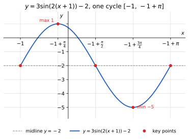
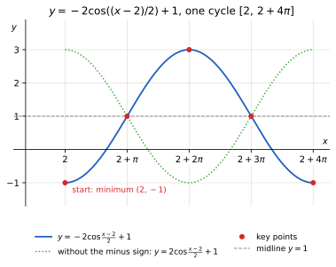
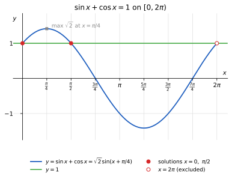
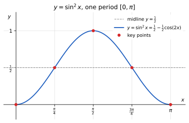

# Homework 7 Solutions

Based on [Lecture 7: Trigonometric Transformations, Equations, and Identities](../Notes/N7.md).

Angles without a degree symbol are in radians, and $k\in\mathbb Z$ means that
$k$ is any integer.

## Section 1: Graph Transformations and Periods

**Exercise 1.** For $y=3\sin(2x)-1$ and $y=\tfrac12\cos(x/3)+2$,
state the amplitude, period, midline, and range. Describe the horizontal
and vertical scale factors relative to the parent graph.

**Solution.** Compare each function with $y=A\sin(B(x-C))+D$ or
$y=A\cos(B(x-C))+D$.

For $y=3\sin(2x)-1$: $A=3$, $B=2$, $C=0$, $D=-1$.

* Amplitude: $\lvert A\rvert=\boxed{3}$; period: $T=2\pi/2=\boxed{\pi}$.
* Midline: $\boxed{y=-1}$; range: $[-1-3,\,-1+3]=\boxed{[-4,2]}$.
* Horizontal scale factor $1/\lvert B\rvert=\boxed{1/2}$: the graph of
  $\sin x$ is compressed horizontally toward the $y$-axis by a factor $1/2$.
  Vertical scale factor $\boxed{3}$: it is stretched vertically by a factor
  $3$, then shifted down $1$.

For $y=\tfrac12\cos(x/3)+2$: $A=1/2$, $B=1/3$, $C=0$, $D=2$.

* Amplitude: $\boxed{1/2}$; period: $T=2\pi/(1/3)=\boxed{6\pi}$.
* Midline: $\boxed{y=2}$; range: $[2-\tfrac12,\,2+\tfrac12]=\boxed{[3/2,\,5/2]}$.
* Horizontal scale factor $1/\lvert B\rvert=\boxed{3}$: the graph of
  $\cos x$ is stretched horizontally away from the $y$-axis by a factor $3$.
  Vertical scale factor $\boxed{1/2}$: it is compressed vertically by a factor
  $1/2$, then shifted up $2$.

Check: $3\sin(2\cdot\pi/4)-1=2$ and $3\sin(2\cdot3\pi/4)-1=-4$ are the
extreme values of the first function; $\tfrac12\cos0+2=5/2$ and
$\tfrac12\cos(3\pi/3)+2=3/2$ (at $x=3\pi$) are those of the second.

**Exercise 2.** Factor the input of $y=2\sin(3x-6)+1$.
State the horizontal shift and period, then explain why the shift is
not $6$ units to the right.

**Solution.** Factor $3$ out of the entire input:
$$
y=2\sin(3x-6)+1=\boxed{2\sin\bigl(3(x-2)\bigr)+1}.
$$
So $B=3$ and $C=2$:
$$
\text{horizontal shift}=\boxed{2\text{ units to the right}},\qquad
\text{period}=\frac{2\pi}{3}\ \Longrightarrow\ \boxed{T=\frac{2\pi}3}.
$$
The shift is the number subtracted from $x$ itself, not from $3x$. A sine
cycle starts where its input is $0$, and $3x-6=0$ at $x=2$, not at $x=6$
(at $x=6$ the input is $12$). The point rule
$(u,v)\mapsto(2+u/3,\ 1+2v)$ shows the order: first compress by $1/3$, then
shift right $2$; the parent starting point $(0,0)$ moves to $(2,1)$.

Shifting $y=2\sin(3x)+1$ right by $6$ would replace $x$ by $x-6$, giving
$2\sin(3(x-6))+1=2\sin(3x-18)+1$, a different function. The number $6$ is a
shift only if it is applied to $y=\sin x$ *before* the compression
($\sin x\to\sin(x-6)\to\sin(3x-6)$); the compression by $1/3$ then shrinks
that shift to $6/3=2$.

Check: $x=2$ gives $2\sin0+1=1$ (start of a cycle on the midline), and
$x=2+\pi/6$ gives $2\sin(\pi/2)+1=3$ (the maximum).

**Exercise 3.** Write the point transformation from $y=\cos x$ to
$y=-2\cos(3(x+1))+4$. Use it to move the parent points $(0,1)$
and $(\pi,-1)$.

**Solution.** The input is already factored, with $x+1=x-(-1)$. Thus
$A=-2$, $B=3$, $C=-1$, $D=4$, and the rule
$(u,v)\mapsto(C+u/B,\ D+Av)$ becomes
$$
\boxed{(u,v)\longmapsto\left(-1+\frac u3,\ 4-2v\right)}.
$$
Then
$$
(0,1)\longmapsto(-1+0,\ 4-2)=\boxed{(-1,2)},\qquad
(\pi,-1)\longmapsto\left(-1+\frac\pi3,\ 4+2\right)
=\boxed{\left(-1+\frac\pi3,\ 6\right)}.
$$
Check: at $x=-1$, $-2\cos0+4=2$; at $x=-1+\pi/3$,
$-2\cos(3\cdot\pi/3)+4=-2(-1)+4=6$. Because $A<0$, the parent maximum
$(0,1)$ becomes the minimum value $2$, and the parent minimum
$(\pi,-1)$ becomes the maximum value $6$.

**Exercise 4.** Sketch one cycle of $y=3\sin(2(x+1))-2$.
Mark five key points and the midline, and state the maximum and minimum.

**Solution.** Here $A=3$, $B=2$, $C=-1$, $D=-2$. The amplitude is $3$, the
period is $T=2\pi/2=\pi$, the midline is $y=-2$, and the key points are
spaced $T/4=\pi/4$ apart starting at $x=C=-1$. The point rule
$(u,v)\mapsto(-1+u/2,\ -2+3v)$ moves the parent sine points
$(0,0),(\pi/2,1),(\pi,0),(3\pi/2,-1),(2\pi,0)$ to

| $x$ | $-1$ | $-1+\frac\pi4$ | $-1+\frac\pi2$ | $-1+\frac{3\pi}4$ | $-1+\pi$ |
|:--:|:--:|:--:|:--:|:--:|:--:|
| $y$ | $-2$ | $1$ | $-2$ | $-5$ | $-2$ |

Therefore
$$
\text{maximum}=-2+3=\boxed{1}\ \text{ at }x=-1+\frac\pi4,\qquad
\text{minimum}=-2-3=\boxed{-5}\ \text{ at }x=-1+\frac{3\pi}4,
$$
and these repeat every $\pi$. The range is $[-5,1]$.
Check: at $x=-1+\pi/4$ the input is $2(x+1)=\pi/2$, so $y=3(1)-2=1$; at
$x=-1+3\pi/4$ it is $3\pi/2$, so $y=3(-1)-2=-5$. The cycle runs from
$x=-1$ to $x=-1+\pi\approx2.14$.

{width=400px}

**Exercise 5.** Sketch one cycle of $y=-2\cos((x-2)/2)+1$.
Explain how the negative sign changes the starting point of a cosine
cycle, and state the period and range.

**Solution.** Factor the input: $(x-2)/2=\tfrac12(x-2)$. So $A=-2$,
$B=1/2$, $C=2$, $D=1$, and
$$
\text{period}=\frac{2\pi}{1/2}=\boxed{4\pi},\qquad
\text{midline }y=1,\qquad
\text{range}=[1-2,\,1+2]=\boxed{[-1,3]}.
$$
The point rule is $(u,v)\mapsto(2+2u,\ 1-2v)$, and the key points are
spaced $T/4=\pi$ apart. The parent cosine points
$(0,1),(\pi/2,0),(\pi,-1),(3\pi/2,0),(2\pi,1)$ move to
$$
(2,-1),\quad(2+\pi,1),\quad(2+2\pi,3),\quad(2+3\pi,1),\quad(2+4\pi,-1).
$$

A cosine cycle starts where its input is $0$; here $\tfrac12(x-2)=0$ at
$x=2$. With a positive coefficient, $y=2\cos((x-2)/2)+1$, the cycle would
start at its maximum $(2,3)$. The negative sign reflects the graph across
the midline (the reflection happens before the vertical shift), so the
parent value $v=1$ becomes $1-2\cdot1=-1$: the cycle **starts at its
minimum** $(2,-1)$, reaches its maximum $3$ in the middle at $x=2+2\pi$,
and ends at the minimum $(2+4\pi,-1)$. The starting $x$-value $2$ does not
change.

Check: $x=2$ gives $-2\cos0+1=-1$; $x=2+\pi$ gives $-2\cos(\pi/2)+1=1$;
$x=2+2\pi$ gives $-2\cos\pi+1=3$.

{width=400px}

## Section 2: Solving Trigonometric Equations

**Exercise 6.** Find all real solutions of $2\sin(x-1)-\sqrt3=0$.
First write the solutions for the inner angle $u=x-1$.

**Solution.** Isolate the sine: $\sin(x-1)=\sqrt3/2$. With $u=x-1$, the
standard equation $\sin u=\sqrt3/2=\sin(\pi/3)$ has all solutions
$$
u=\frac\pi3+2k\pi\quad\text{or}\quad u=\pi-\frac\pi3+2k\pi=\frac{2\pi}3+2k\pi.
$$
Substitute $u=x-1$ and add $1$:
$$
\boxed{x=1+\frac\pi3+2k\pi\quad\text{or}\quad x=1+\frac{2\pi}3+2k\pi}.
$$
No division was needed, so the families keep the period $2\pi$.
Check: $x=1+\pi/3$ gives $2\sin(\pi/3)-\sqrt3=\sqrt3-\sqrt3=0$, and
$x=1+2\pi/3$ gives $2\sin(2\pi/3)-\sqrt3=0$; adding $2k\pi$ does not change
the sine.

**Exercise 7.** Find all real solutions of $\cos(3x-\pi/3)=0$.
Combine any overlapping solution families into one family if possible.

**Solution.** Let $u=3x-\pi/3$. Since $\cos u=0=\cos(\pi/2)$,
$$
u=\frac\pi2+2k\pi\quad\text{or}\quad u=-\frac\pi2+2k\pi.
$$
The second family is $-\pi/2+2k\pi=\pi/2+(2k-1)\pi$, so it adds the odd
multiples of $\pi$ to $\pi/2$, while the first adds the even multiples.
Together they form the single family
$$
u=\frac\pi2+k\pi,
$$
the top and bottom points $(0,\pm1)$ of the unit circle, half a turn apart.
Substitute back, add $\pi/3$, and divide every term by $3$:
$$
3x-\frac\pi3=\frac\pi2+k\pi
\quad\Longrightarrow\quad
3x=\frac{5\pi}6+k\pi
\quad\Longrightarrow\quad
\boxed{x=\frac{5\pi}{18}+\frac{k\pi}3}.
$$
Kept separately, the two families are $x=5\pi/18+2k\pi/3$ and
$x=-\pi/18+2k\pi/3$; since $5\pi/18-\pi/3=-\pi/18$, they are the even and
odd members of the combined family.
Check: $x=5\pi/18$ gives $3x-\pi/3=15\pi/18-6\pi/18=\pi/2$, and
$x=-\pi/18$ gives $-\pi/6-\pi/3=-\pi/2$; cosine is $0$ at both.

**Exercise 8.** Find all real solutions of $\sin(1-2x)=1/2$.
Explain why a term $-k\pi$ can be rewritten as $k\pi$ when describing
all solutions.

**Solution.** Let $u=1-2x$. Since $\sin u=1/2=\sin(\pi/6)$,
$$
u=\frac\pi6+2k\pi\quad\text{or}\quad u=\frac{5\pi}6+2k\pi.
$$
Substitute back, subtract $1$, and divide every term by $-2$:
$$
1-2x=\frac\pi6+2k\pi
\ \Longrightarrow\
-2x=-1+\frac\pi6+2k\pi
\ \Longrightarrow\
x=\frac12-\frac\pi{12}-k\pi,
$$
$$
1-2x=\frac{5\pi}6+2k\pi
\ \Longrightarrow\
-2x=-1+\frac{5\pi}6+2k\pi
\ \Longrightarrow\
x=\frac12-\frac{5\pi}{12}-k\pi.
$$
As $k$ runs through all integers, so does $-k$: the map $k\mapsto-k$ just
lists $\dots,2,1,0,-1,-2,\dots$ in the opposite order. Hence the sets
$\{-k\pi:k\in\mathbb Z\}$ and $\{k\pi:k\in\mathbb Z\}$ are the same set
$\{\dots,-2\pi,-\pi,0,\pi,2\pi,\dots\}$, and renaming $-k$ as $k$ gives
$$
\boxed{x=\frac12-\frac\pi{12}+k\pi\quad\text{or}\quad
x=\frac12-\frac{5\pi}{12}+k\pi}.
$$
Check: $x=\tfrac12-\tfrac\pi{12}$ gives $1-2x=\pi/6$, and
$x=\tfrac12-\tfrac{5\pi}{12}+\pi$ gives $1-2x=5\pi/6-2\pi$; the sine is
$1/2$ in both cases.

**Exercise 9.** Find all real solutions of
$\tan(2x-\pi/6)=-\sqrt3$. Check the original domain.

**Solution.** Let $u=2x-\pi/6$. Since $\tan u=-\sqrt3=\tan(-\pi/3)$ and
tangent has period $\pi$,
$$
u=-\frac\pi3+k\pi.
$$
Substitute back, add $\pi/6$, and divide every term by $2$:
$$
2x-\frac\pi6=-\frac\pi3+k\pi
\quad\Longrightarrow\quad
2x=-\frac\pi6+k\pi
\quad\Longrightarrow\quad
\boxed{x=-\frac\pi{12}+\frac{k\pi}2}
$$
(equivalently $x=5\pi/12+k\pi/2$).

Domain: the original expression requires $\cos(2x-\pi/6)\ne0$, that is,
$2x-\pi/6\ne\pi/2+m\pi$, or $x\ne\pi/3+m\pi/2$ for $m\in\mathbb Z$. Every
candidate has inner angle $-\pi/3+k\pi$, where
$\cos(-\pi/3+k\pi)=\pm\tfrac12\ne0$. So every candidate is in the domain and
none is discarded.
Check: $x=-\pi/12$ gives $\tan(-\pi/3)=-\sqrt3$, and $x=5\pi/12$ gives
$\tan(5\pi/6-\pi/6)=\tan(2\pi/3)=-\sqrt3$.

**Exercise 10.** Solve $2\sin^2x=\sin x$ for all real $x$ by
factoring, then list the solutions on $[0,2\pi)$. Which solutions
would be lost by dividing by $\sin x$?

**Solution.** Move everything to one side and factor:
$$
2\sin^2x-\sin x=0
\quad\Longrightarrow\quad
\sin x\,(2\sin x-1)=0.
$$
Either $\sin x=0$, giving $x=k\pi$, or $\sin x=1/2$, giving
$x=\pi/6+2k\pi$ or $x=5\pi/6+2k\pi$. All real solutions:
$$
\boxed{x=k\pi\quad\text{or}\quad x=\frac\pi6+2k\pi\quad\text{or}\quad
x=\frac{5\pi}6+2k\pi}.
$$
On $[0,2\pi)$, the family $k\pi$ contributes $0$ and $\pi$ ($2\pi$ is
excluded), and the other two contribute $\pi/6$ and $5\pi/6$:
$$
\boxed{x=0,\ \frac\pi6,\ \frac{5\pi}6,\ \pi}.
$$
Dividing by $\sin x$ is allowed only where $\sin x\ne0$; it leaves
$2\sin x=1$ and throws away the whole factor $\sin x=0$. It would lose
$\boxed{x=k\pi}$, which on $[0,2\pi)$ are $x=0$ and $x=\pi$. None of them is
recovered from $2\sin x=1$, since $\sin(k\pi)=0\ne\tfrac12$.
Check: $x=\pi/6$ gives $2(1/2)^2=1/2=\sin(\pi/6)$; at $x=0$ and $x=\pi$ both
sides are $0$.

## Section 3: Proving the Cosine Sum Formula

**Exercise 11.** In the proof, why did we choose $Q$ at angle $-b$
rather than angle $b$? If we choose $Q=(\cos b,\sin b)$ instead and
rotate by $-b$, what formula does the same distance argument give?

**Solution.** The goal is $\cos(a+b)$. The angle from $Q$ (at $-b$) to $P$
(at $a$) is $a-(-b)=a+b$. Rotating by $b$ moves $Q$ to angle $0$, which is
the point $(1,0)$, and moves $P$ to angle $a+b$. With one endpoint at
$(1,0)$, the squared chord length is simply $2-2\cos(a+b)$, so the
rotated chord measures exactly $\cos(a+b)$. If $Q$ were at angle $b$, the
angle between $Q$ and $P$ would be $a-b$, and bringing $Q$ to $(1,0)$
requires rotating by $-b$, which sends $P$ to angle $a-b$. That produces
the difference formula instead.

Carry it out with $P=(\cos a,\sin a)$ and $Q=(\cos b,\sin b)$:
$$
\begin{aligned}
PQ^2
&=(\cos a-\cos b)^2+(\sin a-\sin b)^2\\
&=(\cos^2a+\sin^2a)+(\cos^2b+\sin^2b)-2\cos a\cos b-2\sin a\sin b\\
&=2-2\cos a\cos b-2\sin a\sin b.
\end{aligned}
$$
Rotate both points through angle $-b$. Then $Q$ moves to angle $0$ and
$P$ to angle $a-b$:
$$
P'=(\cos(a-b),\sin(a-b)),\qquad Q'=(1,0),
$$
$$
\begin{aligned}
P'Q'^2
&=(\cos(a-b)-1)^2+\sin^2(a-b)\\
&=\cos^2(a-b)+\sin^2(a-b)-2\cos(a-b)+1\\
&=2-2\cos(a-b).
\end{aligned}
$$
A rotation preserves distance, so
$$
2-2\cos(a-b)=2-2\cos a\cos b-2\sin a\sin b.
$$
Subtracting $2$ and dividing by $-2$ gives the **cosine difference formula**
$$
\boxed{\cos(a-b)=\cos a\cos b+\sin a\sin b}.
$$
As in the lecture, the argument works for all real $a,b$. (Replacing $b$
by $-b$ in it recovers the sum formula.)

**Exercise 12.** Use the cosine sum formula to find
$\cos(7\pi/12)$ exactly. Check that its sign agrees with its quadrant.

**Solution.** Since $7\pi/12=4\pi/12+3\pi/12=\pi/3+\pi/4$,
$$
\begin{aligned}
\cos\frac{7\pi}{12}
&=\cos\frac\pi3\cos\frac\pi4-\sin\frac\pi3\sin\frac\pi4\\
&=\frac12\cdot\frac{\sqrt2}2-\frac{\sqrt3}2\cdot\frac{\sqrt2}2
=\boxed{\frac{\sqrt2-\sqrt6}{4}}\approx-0.2588.
\end{aligned}
$$
Sign check: $\pi/2=6\pi/12<7\pi/12<12\pi/12=\pi$, so $7\pi/12=105^\circ$ is in
quadrant II, where cosine (the $x$-coordinate) is negative. Since
$\sqrt6>\sqrt2$, the value $(\sqrt2-\sqrt6)/4$ is indeed negative.
Cross-check with Exercise 13: $\cos(\pi/12+\pi/2)=-\sin(\pi/12)
=-(\sqrt6-\sqrt2)/4$, using the lecture's value of $\sin(\pi/12)$.

**Exercise 13.** Set $b=\pi/2$ in the cosine sum formula to show
$\cos(a+\pi/2)=-\sin a$. Then set $b=\pi$ to show
$\cos(a+\pi)=-\cos a$.

**Solution.** With $b=\pi/2$, use $\cos(\pi/2)=0$ and $\sin(\pi/2)=1$:
$$
\cos\left(a+\frac\pi2\right)
=\cos a\cos\frac\pi2-\sin a\sin\frac\pi2
=\cos a\cdot0-\sin a\cdot1
=\boxed{-\sin a}.
$$
With $b=\pi$, use $\cos\pi=-1$ and $\sin\pi=0$:
$$
\cos(a+\pi)=\cos a\cos\pi-\sin a\sin\pi
=\cos a\cdot(-1)-\sin a\cdot0
=\boxed{-\cos a}.
$$
Both hold for every real $a$, because the sum formula does. Geometrically,
a quarter turn sends $(\cos a,\sin a)$ to $(-\sin a,\cos a)$ and a half
turn sends it to $(-\cos a,-\sin a)$. Check with $a=\pi/3$:
$\cos(5\pi/6)=-\sqrt3/2=-\sin(\pi/3)$ and $\cos(4\pi/3)=-1/2=-\cos(\pi/3)$.

## Section 4: One Sum Formula Gives the Others

**Exercise 14.** Starting with the sine sum formula alone, use
$\cos(a+b)=\sin((\pi/2-a)-b)$ to derive the cosine sum formula.
First obtain the sine difference formula by replacing $b$ with $-b$.

**Solution.** Assume only
$$
\sin(a+b)=\sin a\cos b+\cos a\sin b\qquad\text{for all real }a,b,
$$
together with the facts that cosine is even, sine is odd, and the
cofunction identities $\sin(\pi/2-x)=\cos x$ and $\cos(\pi/2-x)=\sin x$
(proved geometrically in Section 1 of the lecture, without any sum formula).

*Step 1: sine difference.* Replace $b$ by $-b$ and use
$\cos(-b)=\cos b$, $\sin(-b)=-\sin b$:
$$
\sin(a-b)=\sin a\cos(-b)+\cos a\sin(-b)
=\boxed{\sin a\cos b-\cos a\sin b}.
$$

*Step 2: cosine sum.* By the cofunction identity with $x=a+b$,
$$
\cos(a+b)=\sin\left(\frac\pi2-(a+b)\right)
=\sin\left(\left(\frac\pi2-a\right)-b\right).
$$
Apply Step 1 with first angle $\pi/2-a$ and second angle $b$, then the
cofunction identities with $x=a$:
$$
\begin{aligned}
\cos(a+b)
&=\sin\left(\frac\pi2-a\right)\cos b-\cos\left(\frac\pi2-a\right)\sin b\\
&=\boxed{\cos a\cos b-\sin a\sin b}.
\end{aligned}
$$
Every step holds for all real $a,b$, so the cosine sum formula holds for
all real $a,b$.

**Exercise 15.** Find exact values of $\sin(5\pi/12)$,
$\cos(\pi/12)$, and $\tan(5\pi/12)$ using the sum or difference
formulas.

**Solution.** Use $5\pi/12=3\pi/12+2\pi/12=\pi/4+\pi/6$ and
$\pi/12=\pi/4-\pi/6$:
$$
\sin\frac{5\pi}{12}
=\sin\frac\pi4\cos\frac\pi6+\cos\frac\pi4\sin\frac\pi6
=\frac{\sqrt2}2\cdot\frac{\sqrt3}2+\frac{\sqrt2}2\cdot\frac12
=\boxed{\frac{\sqrt6+\sqrt2}4}\approx0.9659,
$$
$$
\cos\frac{\pi}{12}
=\cos\frac\pi4\cos\frac\pi6+\sin\frac\pi4\sin\frac\pi6
=\frac{\sqrt2}2\cdot\frac{\sqrt3}2+\frac{\sqrt2}2\cdot\frac12
=\boxed{\frac{\sqrt6+\sqrt2}4}\approx0.9659.
$$
For the tangent, $1-\tan\frac\pi4\tan\frac\pi6=1-\frac1{\sqrt3}\ne0$, so the
sum formula applies:
$$
\tan\frac{5\pi}{12}
=\frac{\tan\frac\pi4+\tan\frac\pi6}{1-\tan\frac\pi4\tan\frac\pi6}
=\frac{1+1/\sqrt3}{1-1/\sqrt3}
=\frac{\sqrt3+1}{\sqrt3-1}
=\frac{(\sqrt3+1)^2}{3-1}
=\frac{4+2\sqrt3}{2}
=\boxed{2+\sqrt3}\approx3.732.
$$
Checks: $\sin(5\pi/12)=\cos(\pi/12)$ is expected, since
$5\pi/12=\pi/2-\pi/12$. Also, with the lecture's
$\cos(5\pi/12)=(\sqrt6-\sqrt2)/4$,
$$
\frac{\sin(5\pi/12)}{\cos(5\pi/12)}=\frac{\sqrt6+\sqrt2}{\sqrt6-\sqrt2}
=\frac{(\sqrt6+\sqrt2)^2}{6-2}=\frac{8+4\sqrt3}{4}=2+\sqrt3,
$$
and $(2+\sqrt3)(2-\sqrt3)=1$ matches $\tan(5\pi/12)=1/\tan(\pi/12)$.

**Exercise 16.** Suppose $\sin a=3/5$ with $a$ in quadrant II,
and $\cos b=12/13$ with $b$ in quadrant IV. Find $\sin(a+b)$
and $\cos(a-b)$ exactly.

**Solution.** First find the missing values with
$\sin^2\theta+\cos^2\theta=1$ and the quadrant signs:
$$
\cos^2a=1-\frac9{25}=\frac{16}{25},\ \ \cos a<0\text{ in QII}
\ \Longrightarrow\ \cos a=-\frac45;
$$
$$
\sin^2b=1-\frac{144}{169}=\frac{25}{169},\ \ \sin b<0\text{ in QIV}
\ \Longrightarrow\ \sin b=-\frac5{13}.
$$
Then
$$
\sin(a+b)=\sin a\cos b+\cos a\sin b
=\frac35\cdot\frac{12}{13}+\left(-\frac45\right)\left(-\frac5{13}\right)
=\frac{36}{65}+\frac{20}{65}=\boxed{\frac{56}{65}},
$$
$$
\cos(a-b)=\cos a\cos b+\sin a\sin b
=\left(-\frac45\right)\frac{12}{13}+\frac35\left(-\frac5{13}\right)
=-\frac{48}{65}-\frac{15}{65}=\boxed{-\frac{63}{65}}.
$$
Numerical check: $a=\pi-\arcsin(3/5)\approx2.4981$ and
$b=-\arccos(12/13)\approx-0.3948$, so $\sin(a+b)\approx\sin2.1033\approx0.8615$
and $\cos(a-b)\approx\cos2.8929\approx-0.9692$, matching $56/65$ and
$-63/65$.

**Exercise 17.** Simplify without a calculator:
$$
\sin\frac\pi7\cos\frac{2\pi}7
+\cos\frac\pi7\sin\frac{2\pi}7,
\qquad
\cos(x+y)\cos y+\sin(x+y)\sin y.
$$

**Solution.** The first expression has the form
$\sin a\cos b+\cos a\sin b$ with $a=\pi/7$ and $b=2\pi/7$, so by the sine
sum formula
$$
\sin\frac\pi7\cos\frac{2\pi}7+\cos\frac\pi7\sin\frac{2\pi}7
=\sin\left(\frac\pi7+\frac{2\pi}7\right)
=\boxed{\sin\frac{3\pi}7}.
$$
(Equivalently $\cos(\pi/14)$, since $\pi/2-3\pi/7=\pi/14$.)

The second has the form $\cos A\cos B+\sin A\sin B$ with $A=x+y$ and
$B=y$, so by the cosine difference formula
$$
\cos(x+y)\cos y+\sin(x+y)\sin y=\cos\bigl((x+y)-y\bigr)=\boxed{\cos x}.
$$
Check with $x=\pi/3$, $y=\pi/6$:
$\cos\frac\pi2\cos\frac\pi6+\sin\frac\pi2\sin\frac\pi6=0+\frac12=\cos\frac\pi3$.

**Exercise 18 (sum-to-product formulas).** Use the sine and cosine sum
and difference formulas to prove all four identities:
$$
\sin u+\sin v
=2\sin\frac{u+v}{2}\cos\frac{u-v}{2},
$$
$$
\sin u-\sin v
=2\cos\frac{u+v}{2}\sin\frac{u-v}{2},
$$
$$
\cos u+\cos v
=2\cos\frac{u+v}{2}\cos\frac{u-v}{2},
$$
$$
\cos u-\cos v
=-2\sin\frac{u+v}{2}\sin\frac{u-v}{2}.
$$
Hint: set $a=(u+v)/2$ and $b=(u-v)/2$, so $u=a+b$ and $v=a-b$.
Expand $\sin(a\pm b)$ and $\cos(a\pm b)$, then add or subtract
the resulting expressions.

**Solution.** Let $u,v$ be any real numbers and set
$$
a=\frac{u+v}2,\qquad b=\frac{u-v}2.
$$
Then $a+b=\frac{2u}2=u$ and $a-b=\frac{2v}2=v$. Since the sum and
difference formulas hold for all real $a,b$,
$$
\begin{aligned}
\sin u&=\sin(a+b)=\sin a\cos b+\cos a\sin b,\\
\sin v&=\sin(a-b)=\sin a\cos b-\cos a\sin b,\\
\cos u&=\cos(a+b)=\cos a\cos b-\sin a\sin b,\\
\cos v&=\cos(a-b)=\cos a\cos b+\sin a\sin b.
\end{aligned}
$$
Add or subtract the matching pairs. In each case two of the four products
cancel and the other two double:
$$
\begin{aligned}
\sin u+\sin v&=2\sin a\cos b
=\boxed{2\sin\frac{u+v}{2}\cos\frac{u-v}{2}},\\
\sin u-\sin v&=2\cos a\sin b
=\boxed{2\cos\frac{u+v}{2}\sin\frac{u-v}{2}},\\
\cos u+\cos v&=2\cos a\cos b
=\boxed{2\cos\frac{u+v}{2}\cos\frac{u-v}{2}},\\
\cos u-\cos v&=-2\sin a\sin b
=\boxed{-2\sin\frac{u+v}{2}\sin\frac{u-v}{2}}.
\end{aligned}
$$
Because $u$ and $v$ were arbitrary, all four identities hold for every real
$u,v$. $\blacksquare$

Check with $u=\pi/2$, $v=\pi/6$ (so $a=\pi/3$, $b=\pi/6$):
$\sin u+\sin v=1+\tfrac12=\tfrac32$ and
$2\sin\frac\pi3\cos\frac\pi6=2\cdot\frac{\sqrt3}2\cdot\frac{\sqrt3}2=\frac32$;
$\cos u-\cos v=0-\frac{\sqrt3}2$ and
$-2\sin\frac\pi3\sin\frac\pi6=-2\cdot\frac{\sqrt3}2\cdot\frac12=-\frac{\sqrt3}2$.

**Exercise 19.** Solve $\sin x+\cos x=1$ on $[0,2\pi)$ by
rewriting the left side as $\sqrt2\sin(x+\pi/4)$.

**Solution.** First confirm the rewrite with the sine sum formula:
$$
\sqrt2\sin\left(x+\frac\pi4\right)
=\sqrt2\left(\sin x\cos\frac\pi4+\cos x\sin\frac\pi4\right)
=\sqrt2\cdot\frac{\sqrt2}2(\sin x+\cos x)
=\sin x+\cos x.
$$
So the equation is $\sqrt2\sin(x+\pi/4)=1$, or
$\sin(x+\pi/4)=1/\sqrt2=\sqrt2/2$. With $u=x+\pi/4$,
$$
u=\frac\pi4+2k\pi\quad\text{or}\quad u=\frac{3\pi}4+2k\pi,
$$
so the general solutions are $x=2k\pi$ or $x=\pi/2+2k\pi$.
For $x\in[0,2\pi)$ the inner angle satisfies $\pi/4\le u<9\pi/4$, which
contains $u=\pi/4$ and $u=3\pi/4$ only ($9\pi/4$ is excluded and
$11\pi/4$ is too large). Hence
$$
\boxed{x=0\quad\text{or}\quad x=\frac\pi2}.
$$
Check: $\sin0+\cos0=0+1=1$ and $\sin\frac\pi2+\cos\frac\pi2=1+0=1$.
The graph of $y=\sqrt2\sin(x+\pi/4)$ has amplitude $\sqrt2$ and is the sine
graph shifted left $\pi/4$; it meets $y=1$ at $x=0$ and $x=\pi/2$ (and again
at $2\pi$, which is excluded).

{width=400px}

## Section 5: Double-Angle Formulas

**Exercise 20.** Suppose $\sin\theta=-5/13$ and $\theta$ is in
quadrant III. Find $\sin(2\theta)$, $\cos(2\theta)$, and
$\tan(2\theta)$ exactly.

**Solution.** In quadrant III cosine is negative, so
$$
\cos^2\theta=1-\frac{25}{169}=\frac{144}{169},\qquad
\cos\theta=-\frac{12}{13}.
$$
Then
$$
\sin(2\theta)=2\sin\theta\cos\theta
=2\left(-\frac5{13}\right)\left(-\frac{12}{13}\right)
=\boxed{\frac{120}{169}},
$$
$$
\cos(2\theta)=1-2\sin^2\theta=1-2\cdot\frac{25}{169}
=\boxed{\frac{119}{169}},
\qquad
\tan(2\theta)=\frac{120/169}{119/169}=\boxed{\frac{120}{119}}.
$$
Checks: $\cos^2\theta-\sin^2\theta=\frac{144-25}{169}=\frac{119}{169}$;
with $\tan\theta=5/12$,
$\frac{2\tan\theta}{1-\tan^2\theta}=\frac{5/6}{119/144}=\frac{120}{119}$;
and $120^2+119^2=14400+14161=28561=169^2$. The signs are consistent: since
$\tan\theta=5/12<1$, we have $\pi<\theta<5\pi/4$, so
$2\pi<2\theta<5\pi/2$ and $2\theta$ is coterminal with a quadrant I angle.

**Exercise 21.** Rewrite $\sin x\cos x$ and
$\cos^4x-\sin^4x$ using double-angle identities.

**Solution.** Dividing $\sin(2x)=2\sin x\cos x$ by $2$,
$$
\boxed{\sin x\cos x=\frac12\sin(2x)}.
$$
Factor the difference of squares and use $\cos^2x+\sin^2x=1$:
$$
\cos^4x-\sin^4x=(\cos^2x-\sin^2x)(\cos^2x+\sin^2x)
=(\cos^2x-\sin^2x)\cdot1=\boxed{\cos(2x)}.
$$
Both hold for every real $x$. Check at $x=\pi/6$:
$\sin\frac\pi6\cos\frac\pi6=\frac{\sqrt3}4=\frac12\sin\frac\pi3$, and
$\cos^4\frac\pi6-\sin^4\frac\pi6=\frac9{16}-\frac1{16}=\frac12=\cos\frac\pi3$.

**Exercise 22.** Find all real solutions of $\cos(2x)=\sin x$.
Choose a form of $\cos(2x)$ that gives a quadratic in $\sin x$.

**Solution.** Use $\cos(2x)=1-2\sin^2x$, which involves only $\sin x$:
$$
1-2\sin^2x=\sin x
\quad\Longrightarrow\quad
2\sin^2x+\sin x-1=0
\quad\Longrightarrow\quad
(2\sin x-1)(\sin x+1)=0.
$$
(Expanding, $(2s-1)(s+1)=2s^2+s-1$.)

* $\sin x=\tfrac12$: $\ x=\dfrac\pi6+2k\pi$ or $x=\dfrac{5\pi}6+2k\pi$.
* $\sin x=-1$: $\ x=\dfrac{3\pi}2+2k\pi$.

All real solutions:
$$
\boxed{x=\frac\pi6+2k\pi\quad\text{or}\quad x=\frac{5\pi}6+2k\pi\quad\text{or}\quad
x=\frac{3\pi}2+2k\pi}.
$$
These three families are spaced $2\pi/3$ apart
($\pi/6,\ \pi/6+2\pi/3=5\pi/6,\ \pi/6+4\pi/3=3\pi/2$), so they combine into
the single family $x=\pi/6+2k\pi/3$. On $[0,2\pi)$ they are
$\pi/6,\ 5\pi/6,\ 3\pi/2$.
Check: $\cos\frac\pi3=\frac12=\sin\frac\pi6$;
$\cos\frac{5\pi}3=\frac12=\sin\frac{5\pi}6$;
$\cos3\pi=-1=\sin\frac{3\pi}2$.

**Exercise 23.** Derive $\tan(2x)=2\tan x/(1-\tan^2x)$ and state
the restrictions needed for the displayed identity. Give an $x$ for
which $\tan(2x)$ exists but the expression on the right is undefined.

**Solution.** Where $\cos(2x)\ne0$, the double-angle formulas give
$$
\tan(2x)=\frac{\sin(2x)}{\cos(2x)}=\frac{2\sin x\cos x}{\cos^2x-\sin^2x}.
$$
If also $\cos x\ne0$, divide the numerator and denominator by $\cos^2x$:
$$
\tan(2x)
=\frac{\dfrac{2\sin x\cos x}{\cos^2x}}{\dfrac{\cos^2x-\sin^2x}{\cos^2x}}
=\frac{2\dfrac{\sin x}{\cos x}}{1-\dfrac{\sin^2x}{\cos^2x}}
=\boxed{\frac{2\tan x}{1-\tan^2x}}.
$$
(This is also the tangent sum formula with $a=b=x$.)

Restrictions for the displayed right side:

* $\tan x$ must be defined: $\cos x\ne0$, i.e. $x\ne\dfrac\pi2+k\pi$;
* the denominator must be nonzero: $\tan^2x\ne1$, i.e. $\tan x\ne\pm1$,
  so $x\ne\dfrac\pi4+\dfrac{k\pi}2$.

So the identity holds for
$$
\boxed{x\ne\frac\pi2+k\pi\quad\text{and}\quad x\ne\frac\pi4+\frac{k\pi}2}.
$$
When $\cos x\ne0$, the second condition is the same as $\cos(2x)\ne0$,
because $\cos(2x)=\cos^2x\,(1-\tan^2x)$.

Example: $\boxed{x=\pi/2}$. Then $\tan(2x)=\tan\pi=0$ exists, but
$\tan(\pi/2)$ is undefined, so $2\tan x/(1-\tan^2x)$ is undefined. (Every
$x=\pi/2+k\pi$ works the same way, since $\tan(\pi+2k\pi)=0$.)

**Exercise 24.** Use $\cos(2x)=1-2\sin^2x$ to rewrite $\sin^2x$
as a transformed cosine function. Use this form to state its fundamental
period, midline, and range, and sketch one cycle.

**Solution.** Solve $\cos(2x)=1-2\sin^2x$ for $\sin^2x$:
$2\sin^2x=1-\cos(2x)$, so
$$
\sin^2x=\frac{1-\cos(2x)}2=\boxed{-\frac12\cos(2x)+\frac12}.
$$
This is $A\cos(Bx)+D$ with $A=-1/2$, $B=2$, $D=1/2$:
$$
\text{period}=\frac{2\pi}2=\boxed{\pi},\qquad
\text{midline}\ \boxed{y=\tfrac12},\qquad
\text{range}=\left[\tfrac12-\tfrac12,\ \tfrac12+\tfrac12\right]=\boxed{[0,1]},
$$
with amplitude $1/2$. The period $\pi$ is fundamental: if $p>0$ is a period,
then $\sin^2p=\sin^20=0$, so $p$ is a multiple of $\pi$ and $p\ge\pi$.

The point rule $(u,v)\mapsto(u/2,\ \tfrac12-\tfrac12v)$ moves the parent
cosine points $(0,1),(\pi/2,0),(\pi,-1),(3\pi/2,0),(2\pi,1)$ to
$$
(0,0),\quad\left(\tfrac\pi4,\tfrac12\right),\quad\left(\tfrac\pi2,1\right),\quad
\left(\tfrac{3\pi}4,\tfrac12\right),\quad(\pi,0).
$$
Because $A<0$, the cycle starts at its minimum $0$. Check directly:
$\sin^2\frac\pi4=\frac12$, $\sin^2\frac\pi2=1$, $\sin^2\frac{3\pi}4=\frac12$,
$\sin^2\pi=0$.

{width=400px}
