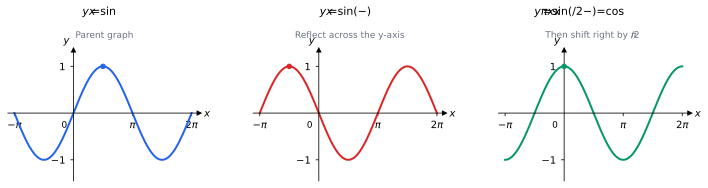
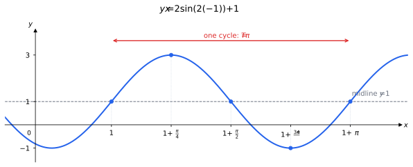
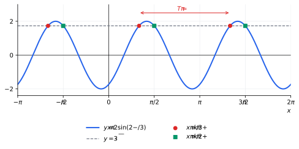
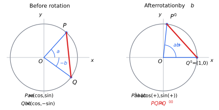

## Lecture 7: Trigonometric Transformations, Equations, and Identities

Lecture 6 introduced the graphs and periods of trigonometric functions.
We begin by reviewing horizontal and vertical shifts, stretches, and
reflections, then use these transformations to sketch new graphs.
We solve trigonometric equations by finding all possible inner angles
and then solving for the original variable. Finally, we prove one
angle-sum formula, derive the other sum and difference formulas, and
apply them to double angles.

Unless a degree symbol appears, **all angles are in radians**. Throughout
this lecture, $k\in\mathbb Z$ means that $k$ is any integer.

### 1. Review: Graph Transformations and Periods

For $y=A\sin(B(x-C))+D$ or $y=A\cos(B(x-C))+D$, with $A,B\neq0$,
recall the following features:

| Feature | Value |
|:--|:--|
| Amplitude | $\lvert A\rvert$ |
| Horizontal scale factor | $1/\lvert B\rvert$ |
| Period | $T=2\pi/\lvert B\rvert$ |
| Horizontal shift | $C$ to the right |
| Midline and range | $y=D$ and $[D-\lvert A\rvert,D+\lvert A\rvert]$ |

**Factor the input first.** A negative $B$ reflects the parent graph
across the $y$-axis before the horizontal shift. A negative $A$ reflects
it across the $x$-axis before the vertical shift. More generally, for
$y=Af(B(x-C))+D$, a point $(u,v)$ on $y=f(x)$ moves to
$$
\boxed{(u,v)\longmapsto\left(C+\frac uB,\ D+Av\right)}.
$$

**Example.** Since
$$
\sin\left(\frac\pi2-x\right)
=\sin\left(-\left(x-\frac\pi2\right)\right),
$$
start with $y=\sin x$, reflect across the $y$-axis, then shift right
by $\pi/2$. A point $(u,\sin u)$ moves to $(\pi/2-u,\sin u)$;
for example, the maximum $(\pi/2,1)$ moves to $(0,1)$.

{width=620px}

The resulting graph is cosine:
$$
\boxed{\sin\left(\frac\pi2-x\right)=\cos x}.
$$
Reflecting $(\cos x,\sin x)$ across $y=x$ swaps its coordinates and
sends its angle to $\pi/2-x$, up to whole turns. This proves the
identity and $\cos(\pi/2-x)=\sin x$ for all real $x$.

**Example (shift and scale).** Sketch
$$
y=2\sin(2(x-1))+1.
$$
Compress $y=\sin x$ horizontally by $1/2$, shift right $1$, stretch
vertically by $2$, then shift up $1$. The amplitude is $2$, period is
$T=\pi$, midline is $y=1$, and range is $[-1,3]$.
The point rule is $(u,v)\mapsto(1+u/2,1+2v)$. Five key points,
spaced $T/4=\pi/4$ apart, give one cycle:

| $x$ | $1$ | $1+\frac\pi4$ | $1+\frac\pi2$ | $1+\frac{3\pi}4$ | $1+\pi$ |
|:--:|:--:|:--:|:--:|:--:|:--:|
| $y$ | $1$ | $3$ | $1$ | $-1$ | $1$ |

{width=600px}

**Exercise 1.** For $y=3\sin(2x)-1$ and $y=\tfrac12\cos(x/3)+2$,
state the amplitude, period, midline, and range. Describe the horizontal
and vertical scale factors relative to the parent graph.

**Exercise 2.** Factor the input of $y=2\sin(3x-6)+1$.
State the horizontal shift and period, then explain why the shift is
not $6$ units to the right.

**Exercise 3.** Write the point transformation from $y=\cos x$ to
$y=-2\cos(3(x+1))+4$. Use it to move the parent points $(0,1)$
and $(\pi,-1)$.

**Exercise 4.** Sketch one cycle of $y=3\sin(2(x+1))-2$.
Mark five key points and the midline, and state the maximum and minimum.

**Exercise 5.** Sketch one cycle of $y=-2\cos((x-2)/2)+1$.
Explain how the negative sign changes the starting point of a cosine
cycle, and state the period and range.

### 2. Solving Trigonometric Equations

Treat the **entire inner angle** as one variable $u$. First solve the
standard trigonometric equation for all real $u$, using $2k\pi$ for
sine and cosine or $k\pi$ for tangent. Then substitute back and solve
for $x$, scaling the entire solution, including the term containing $k$.

The unit circle gives these patterns:

| Equation | All angle solutions, $k\in\mathbb Z$ |
|:--|:--|
| $\sin u=\sin\alpha$ | $u=\alpha+2k\pi$ or $u=\pi-\alpha+2k\pi$ |
| $\cos u=\cos\alpha$ | $u=\alpha+2k\pi$ or $u=-\alpha+2k\pi$ |
| $\tan u=\tan\alpha$ | $u=\alpha+k\pi$, provided $\tan\alpha$ is defined |

Coinciding families should be listed only once. An isolated sine or
cosine outside $[-1,1]$ gives no real solutions.

**Example (a shifted angle).** Solve for all real $x$:
$$
\cos(x-1)=\frac12.
$$
Set $u=x-1$. Since $\cos u=1/2$,
$$
u=\frac\pi3+2k\pi\quad\text{or}\quad u=-\frac\pi3+2k\pi.
$$
Substitute $u=x-1$ and add $1$:
$$
\boxed{x=1+\frac\pi3+2k\pi\quad\text{or}\quad
x=1-\frac\pi3+2k\pi}.
$$

**Example (divide the periodic term too).** Solve for all real $x$:
$$
2\sin\left(2x-\frac\pi3\right)=\sqrt3.
$$
Isolate sine and put $u=2x-\pi/3$. The standard equation
$\sin u=\sqrt3/2$ has all solutions
$$
u=\frac\pi3+2k\pi\quad\text{or}\quad u=\frac{2\pi}3+2k\pi.
$$
Now substitute back:
$$
2x-\frac\pi3=\frac\pi3+2k\pi
\quad\text{or}\quad
2x-\frac\pi3=\frac{2\pi}3+2k\pi.
$$
Add $\pi/3$ and divide every term by $2$:
$$
\boxed{x=\frac\pi3+k\pi\quad\text{or}\quad x=\frac\pi2+k\pi}.
$$
The standard $2k\pi$ term becomes $k\pi$ when we divide by $2$.
Keeping $2k\pi$ would miss every other repetition in each family.

{width=560px}

**Example (tangent).** Solve $\tan(3x+\pi/4)=1$ for all real $x$.
Set $u=3x+\pi/4$. The standard equation $\tan u=1$ gives
$u=\pi/4+k\pi$. Substituting back,
$$
3x+\frac\pi4=\frac\pi4+k\pi
\quad\Longrightarrow\quad
\boxed{x=\frac{k\pi}{3}}.
$$
Every candidate belongs to the domain: its inner angle is
$\pi/4+k\pi$, where cosine is nonzero.

**Restrict an interval only after finding the families.** If the second
example asks for $x\in[0,2\pi)$, keep the members of
$x=\pi/3+k\pi$ and $x=\pi/2+k\pi$ that lie in that interval.
Taking $k=0,1$ in each family gives
$$
\boxed{x=\frac\pi3,\quad\frac\pi2,\quad\frac{4\pi}3,\quad\frac{3\pi}2}.
$$
Both families contribute two solutions; $2\pi$ is excluded by the open
right endpoint.

**Exercise 6.** Find all real solutions of $2\sin(x-1)-\sqrt3=0$.
First write the solutions for the inner angle $u=x-1$.

**Exercise 7.** Find all real solutions of $\cos(3x-\pi/3)=0$.
Combine any overlapping solution families into one family if possible.

**Exercise 8.** Find all real solutions of $\sin(1-2x)=1/2$.
Explain why a term $-k\pi$ can be rewritten as $k\pi$ when describing
all solutions.

**Exercise 9.** Find all real solutions of
$\tan(2x-\pi/6)=-\sqrt3$. Check the original domain.

**Exercise 10.** Solve $2\sin^2x=\sin x$ for all real $x$ by
factoring, then list the solutions on $[0,2\pi)$. Which solutions
would be lost by dividing by $\sin x$?

### 3. Proving the Cosine Sum Formula

An **identity** is true for every input where its expressions are
defined. The angle-sum identities let us evaluate trigonometric functions
of sums using the functions of the individual angles. Trigonometric
functions do not distribute over addition: for example,
$$
\sin\left(\frac\pi2+\frac\pi2\right)=0,
\qquad
\sin\frac\pi2+\sin\frac\pi2=2.
$$
We will prove
$$
\boxed{\cos(a+b)=\cos a\cos b-\sin a\sin b}
$$
using only unit-circle coordinates, the distance formula, symmetry, and
the fact that a rotation preserves distance.

{width=560px}

**Step 1: Choose two points on the unit circle.** Let
$$
P=(\cos a,\sin a),\qquad
Q=(\cos(-b),\sin(-b))=(\cos b,-\sin b).
$$
The squared distance between them is
$$
\begin{aligned}
PQ^2
&=(\cos a-\cos b)^2+(\sin a+\sin b)^2\\
&=(\cos^2a+\sin^2a)+(\cos^2b+\sin^2b)
  -2\cos a\cos b+2\sin a\sin b\\
&=2-2\cos a\cos b+2\sin a\sin b.
\end{aligned}
$$

**Step 2: Rotate both points through angle $b$.** The point $Q$, at
angle $-b$, moves to $(1,0)$. The point $P$, at angle $a$, moves to
the unit-circle point at angle $a+b$:
$$
P'=(\cos(a+b),\sin(a+b)),\qquad Q'=(1,0).
$$
We do not need a coordinate formula for rotation: adding $b$ to the
angle tells us which unit-circle point we reach. The new squared distance
is
$$
\begin{aligned}
P'Q'^2
&=(\cos(a+b)-1)^2+\sin^2(a+b)\\
&=2-2\cos(a+b).
\end{aligned}
$$

**Step 3: Equate the distances.** A rotation preserves distance, so
$$
2-2\cos(a+b)=2-2\cos a\cos b+2\sin a\sin b.
$$
Subtracting $2$ and dividing by $-2$ gives
$$
\boxed{\cos(a+b)=\cos a\cos b-\sin a\sin b}.
$$
The argument works for **all real angles** $a,b$, including negative
angles and angles larger than one turn. It also works when the two
points coincide; no division by a side length was used.

**Example (an exact value).** Since $5\pi/12=\pi/4+\pi/6$,
$$
\begin{aligned}
\cos\frac{5\pi}{12}
&=\cos\frac\pi4\cos\frac\pi6-\sin\frac\pi4\sin\frac\pi6\\
&=\frac{\sqrt2}{2}\cdot\frac{\sqrt3}{2}
 -\frac{\sqrt2}{2}\cdot\frac12
=\boxed{\frac{\sqrt6-\sqrt2}{4}}.
\end{aligned}
$$
This gives $\cos75^\circ$ from values at $45^\circ$ and $30^\circ$.

**Exercise 11.** In the proof, why did we choose $Q$ at angle $-b$
rather than angle $b$? If we choose $Q=(\cos b,\sin b)$ instead and
rotate by $-b$, what formula does the same distance argument give?

**Exercise 12.** Use the cosine sum formula to find
$\cos(7\pi/12)$ exactly. Check that its sign agrees with its quadrant.

**Exercise 13.** Set $b=\pi/2$ in the cosine sum formula to show
$\cos(a+\pi/2)=-\sin a$. Then set $b=\pi$ to show
$\cos(a+\pi)=-\cos a$.

### 4. One Sum Formula Gives the Others

The formulas are connected. Once the cosine sum formula is proved,
the others follow from symmetry, the cofunction identities, and
$\tan x=\sin x/\cos x$.

**Cosine difference: replace $b$ by $-b$.** Since cosine is even and
sine is odd,
$$
\begin{aligned}
\cos(a-b)
&=\cos a\cos(-b)-\sin a\sin(-b)\\
&=\boxed{\cos a\cos b+\sin a\sin b}.
\end{aligned}
$$
The minus in the input changes the minus between the products to a plus.

**Sine sum: turn sine into cosine.** By the cofunction identities,
$$
\begin{aligned}
\sin(a+b)
&=\cos\left(\frac\pi2-(a+b)\right)\\
&=\cos\left(\left(\frac\pi2-a\right)-b\right)\\
&=\cos\left(\frac\pi2-a\right)\cos b
  +\sin\left(\frac\pi2-a\right)\sin b\\
&=\boxed{\sin a\cos b+\cos a\sin b}.
\end{aligned}
$$
Here we used the cosine difference formula just derived. The cofunction
identities were proved geometrically in Section 1, so the reasoning does
not assume the sum formula we are trying to establish.

**Sine difference: replace $b$ by $-b$ again.**
$$
\begin{aligned}
\sin(a-b)
&=\sin a\cos(-b)+\cos a\sin(-b)\\
&=\boxed{\sin a\cos b-\cos a\sin b}.
\end{aligned}
$$

**Tangent sum: divide sine by cosine.** Wherever the denominators
below are nonzero,
$$
\begin{aligned}
\tan(a+b)
&=\frac{\sin(a+b)}{\cos(a+b)}\\
&=\frac{\sin a\cos b+\cos a\sin b}
        {\cos a\cos b-\sin a\sin b}\\
&=\boxed{\frac{\tan a+\tan b}{1-\tan a\tan b}}.
\end{aligned}
$$
The last step divides numerator and denominator by $\cos a\cos b$.
Thus the formula requires $\cos a\neq0$, $\cos b\neq0$, and
$1-\tan a\tan b\neq0$. Under the first two conditions, the last
condition is equivalent to $\cos(a+b)\neq0$.

Replacing $b$ by $-b$ and using $\tan(-b)=-\tan b$ gives
$$
\boxed{\tan(a-b)=\frac{\tan a-\tan b}{1+\tan a\tan b}},
$$
where $\tan a$, $\tan b$, and the displayed quotient are defined.

| Function | Sum formula | Difference formula |
|:--|:--|:--|
| Sine | $\sin(a+b)=\sin a\cos b+\cos a\sin b$ | $\sin(a-b)=\sin a\cos b-\cos a\sin b$ |
| Cosine | $\cos(a+b)=\cos a\cos b-\sin a\sin b$ | $\cos(a-b)=\cos a\cos b+\sin a\sin b$ |
| Tangent | $\tan(a+b)=\dfrac{\tan a+\tan b}{1-\tan a\tan b}$ | $\tan(a-b)=\dfrac{\tan a-\tan b}{1+\tan a\tan b}$ |

The sine and cosine identities hold for every real $a,b$. The tangent
identities hold on their common domains. For example, $a=b=\pi/4$
makes the tangent sum denominator zero, matching the fact that
$\tan(\pi/2)$ is undefined.

**Example (exact sine and tangent values).** Using $\pi/12=\pi/4-\pi/6$,
$$
\sin\frac\pi{12}
=\frac{\sqrt2}{2}\cdot\frac{\sqrt3}{2}
 -\frac{\sqrt2}{2}\cdot\frac12
=\boxed{\frac{\sqrt6-\sqrt2}{4}},
$$
and
$$
\tan\frac\pi{12}
=\frac{1-1/\sqrt3}{1+1/\sqrt3}
=\frac{\sqrt3-1}{\sqrt3+1}
=\boxed{2-\sqrt3}.
$$

**Example (use a sum formula in reverse to solve an equation).** Solve
$$
\sqrt3\sin x+\cos x=1
\qquad\text{on }[0,2\pi).
$$
Recognize the left side as
$$
2\left(\sin x\cos\frac\pi6+\cos x\sin\frac\pi6\right)
=2\sin\left(x+\frac\pi6\right).
$$
Thus $\sin(x+\pi/6)=1/2$, giving
$$
x+\frac\pi6=\frac\pi6+2k\pi
\quad\text{or}\quad
x+\frac\pi6=\frac{5\pi}6+2k\pi.
$$
The general solutions are $x=2k\pi$ or $x=2\pi/3+2k\pi$.
On the requested interval,
$$
\boxed{x=0\quad\text{or}\quad x=\frac{2\pi}3}.
$$
The identity converts a combination of sine and cosine into one shifted
sine function, bringing us back to graph transformations and periodicity.

**Exercise 14.** Starting with the sine sum formula alone, use
$\cos(a+b)=\sin((\pi/2-a)-b)$ to derive the cosine sum formula.
First obtain the sine difference formula by replacing $b$ with $-b$.

**Exercise 15.** Find exact values of $\sin(5\pi/12)$,
$\cos(\pi/12)$, and $\tan(5\pi/12)$ using the sum or difference
formulas.

**Exercise 16.** Suppose $\sin a=3/5$ with $a$ in quadrant II,
and $\cos b=12/13$ with $b$ in quadrant IV. Find $\sin(a+b)$
and $\cos(a-b)$ exactly.

**Exercise 17.** Simplify without a calculator:
$$
\sin\frac\pi7\cos\frac{2\pi}7
+\cos\frac\pi7\sin\frac{2\pi}7,
\qquad
\cos(x+y)\cos y+\sin(x+y)\sin y.
$$

**Exercise 18 (sum-to-product formulas).** Use the sine and cosine sum
and difference formulas to prove all four identities:
$$
\sin u+\sin v
=2\sin\frac{u+v}{2}\cos\frac{u-v}{2},
$$
$$
\sin u-\sin v
=2\cos\frac{u+v}{2}\sin\frac{u-v}{2},
$$
$$
\cos u+\cos v
=2\cos\frac{u+v}{2}\cos\frac{u-v}{2},
$$
$$
\cos u-\cos v
=-2\sin\frac{u+v}{2}\sin\frac{u-v}{2}.
$$
Hint: set $a=(u+v)/2$ and $b=(u-v)/2$, so $u=a+b$ and $v=a-b$.
Expand $\sin(a\pm b)$ and $\cos(a\pm b)$, then add or subtract
the resulting expressions.

**Exercise 19.** Solve $\sin x+\cos x=1$ on $[0,2\pi)$ by
rewriting the left side as $\sqrt2\sin(x+\pi/4)$.

### 5. Double-Angle Formulas

A double angle is a sum with two equal terms: $2x=x+x$. Setting
$a=b=x$ in the sum formulas gives the **double-angle identities**.

**Sine.**
$$
\sin(2x)=\sin x\cos x+\cos x\sin x
=\boxed{2\sin x\cos x}.
$$
Doubling the angle does not simply double the output. For example,
$\sin(2\cdot\pi/6)=\sqrt3/2$, whereas $2\sin(\pi/6)=1$.

**Cosine.** The cosine sum formula gives
$$
\boxed{\cos(2x)=\cos^2x-\sin^2x}.
$$
Using $\sin^2x+\cos^2x=1$, we get two other useful forms:
$$
\boxed{\cos(2x)=2\cos^2x-1=1-2\sin^2x}.
$$
Choose the form that uses the quantity you know, or that expresses an
equation in just one trigonometric function. All three forms hold for
every real $x$.

**Tangent.** Dividing the sine formula by the cosine formula gives
$$
\tan(2x)=\frac{2\sin x\cos x}{\cos^2x-\sin^2x}
=\boxed{\frac{2\tan x}{1-\tan^2x}},
$$
where the final expression requires $\cos x\neq0$ and
$1-\tan^2x\neq0$. The first quotient only requires
$\cos(2x)\neq0$; dividing by $\cos^2x$ introduces the additional
restriction $\cos x\neq0$.

**Example (exact values from one angle).** Suppose $\sin x=3/5$ and
$x$ is in quadrant II. Then $\cos x=-4/5$, so
$$
\sin(2x)=2\cdot\frac35\cdot\left(-\frac45\right)
=\boxed{-\frac{24}{25}},
$$
$$
\cos(2x)=1-2\left(\frac35\right)^2
=\boxed{\frac7{25}},
\qquad
\tan(2x)=\frac{-24/25}{7/25}=\boxed{-\frac{24}{7}}.
$$
We can calculate all three values without first finding $x$.

**Example (solving with a double-angle identity).** Find all real
solutions of
$$
\sin(2x)=\sin x.
$$
Use the sine double-angle formula, move everything to one side, and
factor:
$$
2\sin x\cos x-\sin x=0
\quad\Longrightarrow\quad
\sin x(2\cos x-1)=0.
$$
Thus $\sin x=0$ or $\cos x=1/2$, giving
$$
\boxed{x=k\pi\quad\text{or}\quad
x=\frac\pi3+2k\pi\quad\text{or}\quad
x=-\frac\pi3+2k\pi}.
$$
Dividing by $\sin x$ would lose the solutions $x=k\pi$.

**Rewriting squares.** Solving the cosine double-angle identities for
the squared functions gives
$$
\boxed{\sin^2x=\frac{1-\cos(2x)}2},\qquad
\boxed{\cos^2x=\frac{1+\cos(2x)}2}.
$$
These express a square in terms of a cosine with twice the angle. For
example, $\sin^2x$ is a transformed cosine with midline $y=1/2$,
range $[0,1]$, and period $\pi$.

**Exercise 20.** Suppose $\sin\theta=-5/13$ and $\theta$ is in
quadrant III. Find $\sin(2\theta)$, $\cos(2\theta)$, and
$\tan(2\theta)$ exactly.

**Exercise 21.** Rewrite $\sin x\cos x$ and
$\cos^4x-\sin^4x$ using double-angle identities.

**Exercise 22.** Find all real solutions of $\cos(2x)=\sin x$.
Choose a form of $\cos(2x)$ that gives a quadratic in $\sin x$.

**Exercise 23.** Derive $\tan(2x)=2\tan x/(1-\tan^2x)$ and state
the restrictions needed for the displayed identity. Give an $x$ for
which $\tan(2x)$ exists but the expression on the right is undefined.

**Exercise 24.** Use $\cos(2x)=1-2\sin^2x$ to rewrite $\sin^2x$
as a transformed cosine function. Use this form to state its fundamental
period, midline, and range, and sketch one cycle.
