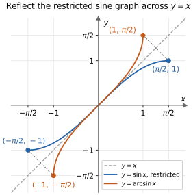
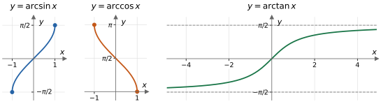

## Lecture 8: Half-Angle Identities, Inverse Trigonometric Functions, and Combining Sine and Cosine

We begin by deriving half-angle formulas from the double-angle identities
in Lecture 7, then collect the main trigonometric identities in one place.
Next we connect trigonometry with the inverse functions from Lecture 4:
how can we recover an angle from its sine, cosine, or tangent? Finally, we
use the angle-sum formulas to explain why $\sin x+\cos x$ is itself a
shifted and stretched sine wave.

Unless a degree symbol appears, **all angles are in radians**. Throughout
this lecture, $k\in\mathbb Z$ means that $k$ is any integer.

### 1. Half-Angle Formulas

The double-angle formulas tell us about $2u$ from information about $u$.
Reading them in reverse lets us find trigonometric values at **half** a
known angle. Put $u=x/2$ in
$\cos(2u)=1-2\sin^2u=2\cos^2u-1$:
$$
\cos x=1-2\sin^2\frac x2
\qquad\text{and}\qquad
\cos x=2\cos^2\frac x2-1.
$$
Solving for the squares gives
$$
\sin^2\frac x2=\frac{1-\cos x}{2},\qquad
\cos^2\frac x2=\frac{1+\cos x}{2}.
$$
Taking square roots gives the **half-angle formulas**:
$$
\boxed{\sin\frac x2=\pm\sqrt{\frac{1-\cos x}{2}}},\qquad
\boxed{\cos\frac x2=\pm\sqrt{\frac{1+\cos x}{2}}}.
$$
Choose each sign from the quadrant of **$x/2$**, not the quadrant of
$x$. The $\pm$ does not mean that the function has two values. It means
that the square determines the magnitude, and the angle determines the
sign. The sine and cosine signs must be chosen separately.

Dividing the squared formulas and taking a square root also gives
$$
\boxed{\tan\frac x2=\pm\sqrt{\frac{1-\cos x}{1+\cos x}}},
\qquad x\ne(2k+1)\pi.
$$
Again choose the sign from $x/2$. The excluded angles make
$\cos(x/2)=0$, so tangent is undefined there.

**Tangent without a square root.** Use the double-angle identities in
the forms $\sin x=2\sin(x/2)\cos(x/2)$, $1+\cos x=2\cos^2(x/2)$, and
$1-\cos x=2\sin^2(x/2)$:
$$
\frac{\sin x}{1+\cos x}
=\frac{2\sin(x/2)\cos(x/2)}{2\cos^2(x/2)}
=\tan\frac x2.
$$
Similarly,
$$
\frac{1-\cos x}{\sin x}
=\frac{2\sin^2(x/2)}{2\sin(x/2)\cos(x/2)}
=\tan\frac x2.
$$
Thus the useful rational forms are
$$
\boxed{\tan\frac x2=\frac{\sin x}{1+\cos x}}
\quad\bigl(x\ne(2k+1)\pi\bigr),
$$
$$
\boxed{\tan\frac x2=\frac{1-\cos x}{\sin x}}
\quad\bigl(x\ne k\pi\bigr).
$$
These forms need **no sign choice**. Since $1+\cos x\ge0$ and
$1-\cos x\ge0$, both quotients show that $\tan(x/2)$ always has the
same sign as $\sin x$.

The second form has a smaller domain: at $x=0$, for example,
$\tan(x/2)=0$ and the first quotient equals $0$, but the second
quotient is $0/0$ and is undefined.

**Example (a new exact angle).** Find $\sin(\pi/8)$ and
$\cos(\pi/8)$. Here $x=\pi/4$ and $x/2=\pi/8$ is in quadrant I,
so both signs are positive:
$$
\sin\frac\pi8
=\sqrt{\frac{1-\sqrt2/2}{2}}
=\boxed{\frac{\sqrt{2-\sqrt2}}2},
$$
$$
\cos\frac\pi8
=\sqrt{\frac{1+\sqrt2/2}{2}}
=\boxed{\frac{\sqrt{2+\sqrt2}}2}.
$$
Their squares add to $1$, as required.

**Example (the half-angle has a different quadrant).** Suppose
$\cos x=-7/25$ and $\pi<x<3\pi/2$. Find all three functions of
$x/2$. Halving the entire interval gives
$$
\frac\pi2<\frac x2<\frac{3\pi}4,
$$
so $x/2$ is in quadrant II: sine is positive, cosine and tangent
are negative. Therefore
$$
\sin\frac x2=\sqrt{\frac{1+7/25}{2}}=\boxed{\frac45},
\qquad
\cos\frac x2=-\sqrt{\frac{1-7/25}{2}}=\boxed{-\frac35},
$$
$$
\tan\frac x2=\frac{4/5}{-3/5}=\boxed{-\frac43}.
$$
The value $\cos x=-7/25$ alone is not enough: replacing $x$ by
$x+2\pi$ leaves $\cos x$ unchanged but adds $\pi$ to $x/2$, which
reverses the signs of $\sin(x/2)$ and $\cos(x/2)$. Always halve the
**given interval** for $x$.

**Example (using a rational form).** Since $\pi/12$ is half of
$\pi/6$,
$$
\tan\frac\pi{12}
=\frac{\sin(\pi/6)}{1+\cos(\pi/6)}
=\frac{1/2}{1+\sqrt3/2}
=\frac1{2+\sqrt3}
=\boxed{2-\sqrt3}.
$$
This agrees with the difference-angle calculation in Lecture 7.

**Exercise 1.** Use half-angle formulas to find $\sin(\pi/12)$
and $\cos(\pi/12)$ exactly. Explain why both signs are positive.

**Exercise 2.** Suppose $\cos x=5/13$ and $3\pi/2<x<2\pi$.
Find $\sin(x/2)$, $\cos(x/2)$, and $\tan(x/2)$ exactly.
First locate $x/2$ in a quadrant.

**Exercise 3.** Find $\sin(5\pi/8)$ and $\cos(5\pi/8)$ exactly
by halving $5\pi/4$. Explain the different signs.

**Exercise 4.** Use $\tan(x/2)=\sin x/(1+\cos x)$ to show
$\tan(\pi/8)=\sqrt2-1$.

**Exercise 5.** Explain why
$\sqrt{(1-\cos(2x))/2}=|\sin x|$, rather than always $\sin x$.
Evaluate both $\sqrt{(1-\cos(2x))/2}$ and $\sin x$ at $x=-\pi/6$.

**Exercise 6.** At each of $x=0,\pi,2\pi$, decide which of
$\tan(x/2)$, $\sin x/(1+\cos x)$, and $(1-\cos x)/\sin x$
are defined. Evaluate those that are defined.

### 2. Summary of Trigonometric Identities

The following collects the main identities from Lectures 5--7 together
with the half-angle formulas above. An identity holds wherever **both
sides are defined**. Every denominator must be nonzero; cancellation
does not restore inputs excluded from an original expression.

**Reciprocal, quotient, and Pythagorean identities.**
$$
\csc x=\frac1{\sin x},\qquad
\sec x=\frac1{\cos x},\qquad
\cot x=\frac{\cos x}{\sin x},\qquad
\tan x=\frac{\sin x}{\cos x}.
$$
Also $\cot x=1/\tan x$ on their common domain.
$$
\sin^2x+\cos^2x=1,\qquad
1+\tan^2x=\sec^2x,\qquad
1+\cot^2x=\csc^2x.
$$

**Symmetry, periodicity, and complementary angles.**
$$
\sin(-x)=-\sin x,\qquad
\cos(-x)=\cos x,\qquad
\tan(-x)=-\tan x,
$$
$$
\sin(x+2k\pi)=\sin x,\quad
\cos(x+2k\pi)=\cos x,\quad
\tan(x+k\pi)=\tan x,
$$
$$
\sin\left(\frac\pi2-x\right)=\cos x,\qquad
\cos\left(\frac\pi2-x\right)=\sin x,\qquad
\tan\left(\frac\pi2-x\right)=\cot x.
$$
Taking reciprocals gives the corresponding identities for secant,
cosecant, and cotangent wherever the expressions are defined.

**Sum and difference formulas.** Take the upper signs together or
the lower signs together:
$$
\sin(a\pm b)=\sin a\cos b\pm\cos a\sin b,
$$
$$
\cos(a\pm b)=\cos a\cos b\mp\sin a\sin b,
$$
$$
\tan(a\pm b)=\frac{\tan a\pm\tan b}{1\mp\tan a\tan b}.
$$
The tangent formulas require $\cos a\ne0$, $\cos b\ne0$, and a
nonzero denominator in the displayed quotient.

**Double angles and power reduction.**
$$
\sin(2x)=2\sin x\cos x,
$$
$$
\cos(2x)=\cos^2x-\sin^2x=1-2\sin^2x=2\cos^2x-1,
$$
$$
\tan(2x)=\frac{2\tan x}{1-\tan^2x},
\qquad \cos x\ne0,\quad \tan^2x\ne1,
$$
$$
\sin^2x=\frac{1-\cos(2x)}2,\qquad
\cos^2x=\frac{1+\cos(2x)}2.
$$
Replacing $x$ by $x/2$ in the last line and selecting signs gives
the half-angle formulas in Section 1.

**Product-to-sum formulas.** Adding or subtracting the angle-sum
and angle-difference identities gives
$$
\sin a\sin b=\frac{\cos(a-b)-\cos(a+b)}2,
$$
$$
\cos a\cos b=\frac{\cos(a-b)+\cos(a+b)}2,
$$
$$
\sin a\cos b=\frac{\sin(a+b)+\sin(a-b)}2.
$$
For example, adding $\sin(a+b)$ and $\sin(a-b)$ cancels the
$\cos a\sin b$ terms and leaves $2\sin a\cos b$, proving the
last formula. Interchanging $a,b$ also gives
$\cos a\sin b=[\sin(a+b)-\sin(a-b)]/2$.

**Sum-to-product formulas.** These are the identities from Lecture 7,
Exercise 18:
$$
\sin u+\sin v=2\sin\frac{u+v}{2}\cos\frac{u-v}{2},
$$
$$
\sin u-\sin v=2\cos\frac{u+v}{2}\sin\frac{u-v}{2},
$$
$$
\cos u+\cos v=2\cos\frac{u+v}{2}\cos\frac{u-v}{2},
$$
$$
\cos u-\cos v=-2\sin\frac{u+v}{2}\sin\frac{u-v}{2}.
$$
To derive them, substitute $a=(u+v)/2$, $b=(u-v)/2$ into the
product-to-sum identities, so that $a+b=u$ and $a-b=v$.

**How to choose an identity.** A sum inside an angle suggests an
angle-sum formula; squares suggest Pythagorean or power-reduction
identities; a half angle suggests Section 1. Products can be rewritten
as sums, and sums can be factored into products. For equations,
factoring preserves solutions that division by a possibly zero factor
would lose.

**Example (turn a sum into a product to solve an equation).** Solve
$\sin(3x)+\sin x=0$ for all real $x$. Sum-to-product gives
$$
2\sin(2x)\cos x=0.
$$
Hence $\sin(2x)=0$ or $\cos x=0$, giving $x=k\pi/2$ or
$x=\pi/2+k\pi$. The second family is already contained in the first,
so all solutions are
$$
\boxed{x=\frac{k\pi}{2},\qquad k\in\mathbb Z}.
$$

**Exercise 7.** Rewrite $\cos(5x)\cos x$ as a sum of two cosine
terms, and $\sin(3x)\sin x$ as a difference of two cosine terms.

**Exercise 8.** Prove $\sin(3x)-\sin x=2\cos(2x)\sin x$.
Then find all real solutions of $\sin(3x)=\sin x$ by factoring.

**Exercise 9.** Solve $\cos x\cos(3x)=\sin x\sin(3x)$ on
$[0,2\pi)$. Recognize an angle-sum formula after moving all terms
to one side.

With the identity toolkit assembled, we now turn to recovering angles
from trigonometric values.

### 3. Why Trigonometric Functions Need Restricted Domains

An inverse function must return exactly one input for each output.
However, sine is not one-to-one on $\mathbb R$: for example,
$$
\sin\frac\pi6=\sin\frac{5\pi}6=\frac12.
$$
Periodicity gives infinitely many more angles with that same sine.
Thus the question “which angle has sine $1/2$?” has many answers.
To define an inverse **function**, we first choose an interval on which
sine takes each value in $[-1,1]$ exactly once.

The standard choices are:

| Function | Restricted angle interval | Outputs on this interval |
|:--|:--|:--|
| $\sin\theta$ | $[-\pi/2,\pi/2]$ | $[-1,1]$, increasing |
| $\cos\theta$ | $[0,\pi]$ | $[-1,1]$, decreasing |
| $\tan\theta$ | $(-\pi/2,\pi/2)$ | $\mathbb R$, increasing |

Each restriction passes the horizontal line test. Tangent's endpoints
are excluded because tangent is undefined at $\pm\pi/2$.

**Definition.** The inverse functions return the unique angle in the
chosen interval:
$$
\boxed{\theta=\arcsin u
\quad\Longleftrightarrow\quad
\sin\theta=u,\quad -\frac\pi2\le\theta\le\frac\pi2},
$$
$$
\boxed{\theta=\arccos u
\quad\Longleftrightarrow\quad
\cos\theta=u,\quad 0\le\theta\le\pi},
$$
$$
\boxed{\theta=\arctan u
\quad\Longleftrightarrow\quad
\tan\theta=u,\quad -\frac\pi2<\theta<\frac\pi2}.
$$
These selected outputs are called **principal values**.

**Notation warning.** Calculators often write $\sin^{-1}u$ for
$\arcsin u$. Here the superscript $-1$ means inverse function, not
reciprocal:
$$
\sin^{-1}u=\arcsin u,\qquad
\frac1{\sin u}=\csc u.
$$
For example, $\arcsin(1/2)=\pi/6$, while $\csc(\pi/6)=2$.
An inverse trigonometric function takes a ratio as input and returns an
angle; a trigonometric function takes an angle and returns a ratio.

**Exercise 10.** Give two different angles with cosine $1/2$.
Which one is returned by $\arccos(1/2)$, and why?

**Exercise 11.** Explain why $[0,\pi]$ is not a suitable interval for
defining inverse sine, even though it is suitable for inverse cosine.

**Exercise 12.** Explain the difference between $\tan^{-1}(1)$ and
$1/\tan(\pi/4)$. Evaluate both.

### 4. Principal Values, Domains, Ranges, and Graphs

The domain and range exchange when we take an inverse:

| Inverse function | Domain | Range (principal angles) |
|:--|:--|:--|
| $y=\arcsin x$ | $[-1,1]$ | $[-\pi/2,\pi/2]$ |
| $y=\arccos x$ | $[-1,1]$ | $[0,\pi]$ |
| $y=\arctan x$ | $\mathbb R$ | $(-\pi/2,\pi/2)$ |

To sketch an inverse, reflect the **restricted** original graph across
$y=x$: each point $(a,b)$ becomes $(b,a)$. For example, the endpoints
$(\pi/2,1)$ and $(-\pi/2,-1)$ of the restricted sine graph become the
endpoints $(1,\pi/2)$ and $(-1,-\pi/2)$ of the inverse sine graph,
and $(\pi/6,1/2)$ becomes $(1/2,\pi/6)$.

{width=360px}

**Example (choose the angle in the principal range).**
$$
\arcsin\left(-\frac{\sqrt3}{2}\right)=-\frac\pi3,\qquad
\arccos\left(-\frac{\sqrt3}{2}\right)=\frac{5\pi}6,\qquad
\arctan(-1)=-\frac\pi4.
$$
Although $4\pi/3$ also has sine $-\sqrt3/2$, it is outside the range
of arcsine. Although $-5\pi/6$ has cosine $-\sqrt3/2$, it is outside
the range of arccosine.

Some useful values are:

| $u$ | $-1$ | $-1/2$ | $0$ | $1/2$ | $1$ |
|:--:|:--:|:--:|:--:|:--:|:--:|
| $\arcsin u$ | $-\pi/2$ | $-\pi/6$ | $0$ | $\pi/6$ | $\pi/2$ |
| $\arccos u$ | $\pi$ | $2\pi/3$ | $\pi/2$ | $\pi/3$ | $0$ |

{width=620px}

Arcsine and arctangent are increasing and odd; arccosine is decreasing
and is neither even nor odd. Instead, since $\cos(\pi-\theta)=-\cos\theta$
and $\pi-\theta$ stays in $[0,\pi]$,
$$
\arccos(-u)=\pi-\arccos u,\qquad -1\le u\le1.
$$
For example, $\arccos(-1/2)=\pi-\pi/3=2\pi/3$, as in the table.
The horizontal asymptotes of arctangent
are $y=\pm\pi/2$, and its graph never reaches them. These come from
reflecting the vertical asymptotes of the restricted tangent graph.
The inverse functions are not periodic.

**Calculator mode.** In radian mode, $\arcsin(0.3)\approx0.3047$.
In degree mode the same angle is approximately $17.46^\circ$.
Neither is a familiar special angle, but the inverse function is still
well-defined. The expressions $\arcsin(2)$ and $\arccos(-2)$ have
no real values, while $\arctan(2)$ is defined.

**Exercise 13.** Evaluate exactly:
$\arcsin(\sqrt2/2)$, $\arccos(-1/2)$, $\arctan(\sqrt3)$,
$\arcsin(-1)$, and $\arccos(0)$.

**Exercise 14.** Which expressions have real values?
$\arcsin(3/2)$, $\arccos(-1)$, $\arctan(100)$, and
$\arccos(-\sqrt2)$. Explain using domains.

**Exercise 15.** Sketch $y=\arccos x$, marking its endpoints and
$y$-intercept. Explain why its graph is decreasing.

### 5. Compositions: When Do the Functions Cancel?

Applying a trigonometric function to its inverse returns the original
input throughout the inverse function's domain:
$$
\sin(\arcsin u)=u,\quad \cos(\arccos u)=u
\qquad(-1\le u\le1),
$$
$$
\tan(\arctan u)=u\qquad(u\in\mathbb R).
$$
In the reverse order, cancellation is valid only on the chosen
principal angle interval:
$$
\arcsin(\sin\theta)=\theta
\quad\text{for }-\frac\pi2\le\theta\le\frac\pi2,
$$
$$
\arccos(\cos\theta)=\theta
\quad\text{for }0\le\theta\le\pi,
$$
$$
\arctan(\tan\theta)=\theta
\quad\text{for }-\frac\pi2<\theta<\frac\pi2.
$$
Outside these intervals, find the angle in the principal range with
the same trigonometric value.

**Example (an angle outside the principal range).**
$$
\arcsin\left(\sin\frac{5\pi}6\right)
=\arcsin\frac12=\boxed{\frac\pi6},
$$
$$
\arccos\left(\cos\frac{7\pi}6\right)
=\arccos\left(-\frac{\sqrt3}{2}\right)
=\boxed{\frac{5\pi}6},
$$
$$
\arctan\left(\tan\frac{3\pi}4\right)
=\arctan(-1)=\boxed{-\frac\pi4}.
$$

**Example (different functions in a composition).** Find
$\cos(\arcsin(-3/5))$. Set $\theta=\arcsin(-3/5)$. Then
$\sin\theta=-3/5$ and $-\pi/2\le\theta\le\pi/2$, so cosine
is nonnegative. The Pythagorean identity gives
$$
\cos\theta=\sqrt{1-\sin^2\theta}
=\sqrt{1-\frac9{25}}=\boxed{\frac45}.
$$
The principal range determines the sign of the square root. In general,
$$
\boxed{\cos(\arcsin u)=\sqrt{1-u^2}},\qquad -1\le u\le1.
$$
Similarly, if $\theta=\arctan t$, then $-\pi/2<\theta<\pi/2$, so
$\cos\theta>0$. Since $1+\tan^2\theta=1/\cos^2\theta$, we get
$\cos\theta=1/\sqrt{1+t^2}$, and then
$\sin\theta=\tan\theta\cos\theta$. Therefore
$$
\boxed{\cos(\arctan t)=\frac1{\sqrt{1+t^2}},\qquad
\sin(\arctan t)=\frac{t}{\sqrt{1+t^2}}},\qquad t\in\mathbb R.
$$
The sine formula retains the sign of $t$; a triangle with positive
side lengths alone would not record that sign.

**Exercise 16.** Evaluate exactly:
$\arcsin(\sin(4\pi/3))$, $\arccos(\cos(-\pi/3))$, and
$\arctan(\tan(5\pi/6))$.

**Exercise 17.** Find $\sin(\arccos(-5/13))$ and
$\tan(\arcsin(3/5))$. State the principal range used in each case.

**Exercise 18.** Simplify $\sin(\arctan(-2))$ exactly. Explain
why its sign must be negative.

**Exercise 19.** Prove
$\arcsin u+\arccos u=\pi/2$ for $-1\le u\le1$.
Hint: put $\theta=\arcsin u$ and check both the cosine and the
range of $\pi/2-\theta$.

### 6. An Inverse Value Versus All Solutions

An inverse function returns **one principal angle**. Solving a
trigonometric equation usually requires more angles, obtained from
symmetry and periodicity.

| Equation | Principal angle | All real solutions |
|:--|:--|:--|
| $\sin x=c$, $\lvert c\rvert\le1$ | $\alpha=\arcsin c$ | $x=\alpha+2k\pi$ or $x=\pi-\alpha+2k\pi$ |
| $\cos x=c$, $\lvert c\rvert\le1$ | $\beta=\arccos c$ | $x=\beta+2k\pi$ or $x=-\beta+2k\pi$ |
| $\tan x=c$, $c\in\mathbb R$ | $\gamma=\arctan c$ | $x=\gamma+k\pi$ |

At $c=\pm1$, the two sine or cosine families coincide; list that
family only once. For $|c|>1$, a sine or cosine equation has no real
solutions.

**Example (a value not on the special-angle table).** Solve
$\sin x=0.3$ on $[0,2\pi)$. Let $\alpha=\arcsin(0.3)$.
Since $0<\alpha<\pi/2$, the two solutions are
$$
\boxed{x=\arcsin(0.3)\quad\text{or}\quad
x=\pi-\arcsin(0.3)},
$$
approximately $0.3047$ and $2.8369$ radians. Giving only
$x=\arcsin(0.3)$ would miss the second solution.

**Example (a transformed angle).** Solve $\cos(2x-\pi/3)=-1/3$
for all real $x$. Put $\beta=\arccos(-1/3)$, so $\pi/2<\beta<\pi$.
Then
$$
2x-\frac\pi3=\pm\beta+2k\pi,
\qquad
\boxed{x=\frac\pi6\pm\frac12\arccos(-1/3)+k\pi}.
$$
The $\pm$ sign records two families. Solving for $x$ divides
$2k\pi$ by $2$, so consecutive solutions in each family are $\pi$
apart.

**Exercise 20.** Solve $\cos x=2/5$ on $[0,2\pi)$. Give exact
answers using inverse cosine.

**Exercise 21.** Find all real solutions of $\tan(3x)=2$.

**Exercise 22.** Solve $\sin x=-1/3$ on $[0,2\pi)$.
Use $\alpha=\arcsin(1/3)$ to express two positive angles.

### 7. Why $\sin x+\cos x$ Is Still a Sine Wave

Adding two functions means adding their **outputs at the same input**.
Here the result has a particularly simple form. The sine sum formula gives
$$
\begin{aligned}
\sin\left(x+\frac\pi4\right)
&=\sin x\cos\frac\pi4+\cos x\sin\frac\pi4\\
&=\frac{\sqrt2}{2}(\sin x+\cos x).
\end{aligned}
$$
Multiplying by $\sqrt2$ yields
$$
\boxed{\sin x+\cos x
=\sqrt2\sin\left(x+\frac\pi4\right)
=\sqrt2\cos\left(x-\frac\pi4\right)}.
$$
Thus the sum is a **sinusoidal function**: a shifted and stretched
sine or cosine. Its amplitude is $\sqrt2$, its period is $2\pi$,
its midline is $y=0$, and its range is $[-\sqrt2,\sqrt2]$.
In the sine form the shift is $\pi/4$ to the left; in the cosine form
it is $\pi/4$ to the right. Both describe the same graph.

{width=600px}

**Why is the maximum not $2$?** Sine and cosine cannot both equal
$1$ at the same angle. The largest sum is $\sqrt2$, reached when
both equal $\sqrt2/2$. From the shifted sine form,
$$
\begin{array}{ll}
\text{Maximum }\sqrt2:&x=\pi/4+2k\pi,\\
\text{Minimum }-\sqrt2:&x=5\pi/4+2k\pi,\\
\text{Zeros}:&x=-\pi/4+k\pi.
\end{array}
$$
As a second check,
$(\sin x+\cos x)^2=1+\sin(2x)\le2$.
The values at $x=\pi/4$ and $x=5\pi/4$ show that both bounds
are attained.

**Example (solve using the new form).** Solve
$\sin x+\cos x=1$ on $[0,2\pi)$. We obtain
$$
\sin\left(x+\frac\pi4\right)=\frac1{\sqrt2}.
$$
Thus $x+\pi/4=\pi/4+2k\pi$ or $3\pi/4+2k\pi$, so
$x=2k\pi$ or $x=\pi/2+2k\pi$. On the requested interval,
$$
\boxed{x=0\quad\text{or}\quad x=\frac\pi2}.
$$

**Exercise 23.** Rewrite $\sin x-\cos x$ as a single shifted
sine function. State its amplitude, period, and range.

**Exercise 24.** Sketch one cycle of $\sin x+\cos x$, starting
at $x=-\pi/4$. Mark five key points a quarter-period apart.

**Exercise 25.** Solve $\sin x+\cos x=-1$ on $[0,2\pi)$.

**Exercise 26.** Explain why $\sin x+\cos x=3/2$ has no real
solutions, even though each term is at most $1$.

### 8. The General Combination $a\sin x+b\cos x$

The same idea works for any real constants $a,b$, not both zero.
We seek an amplitude $R>0$ and an angle $\phi$ such that
$$
a\sin x+b\cos x=R\sin(x+\phi).
$$
Expanding the right side shows what is required:
$$
R\sin(x+\phi)=(R\cos\phi)\sin x+(R\sin\phi)\cos x.
$$
Match coefficients and square and add:
$$
R\cos\phi=a,\qquad R\sin\phi=b,
\qquad R^2=a^2+b^2.
$$
Consequently,
$$
\boxed{R=\sqrt{a^2+b^2},\qquad
\cos\phi=\frac aR,\quad\sin\phi=\frac bR}.
$$
The point $(a/R,b/R)$ lies on the unit circle, so such an angle
$\phi$ always exists and is determined up to whole turns. The range
of the combination is $[-R,R]$, and its period is $2\pi$.

**Choose the correct quadrant.** When $a\ne0$, the angle satisfies
$\tan\phi=b/a$. However, $\arctan(b/a)$ always lies in
$(-\pi/2,\pi/2)$, where cosine is positive. Therefore:

- if $a>0$, take $\phi=\arctan(b/a)$;
- if $a<0$, take $\phi=\arctan(b/a)+\pi$;
- if $a=0$, take $\phi=\pi/2$ when $b>0$ and $\phi=-\pi/2$ when $b<0$.

Adding $\pi$ keeps the tangent but reverses the signs of both the
cosine and the sine. Check **both** $\cos\phi=a/R$ and
$\sin\phi=b/R$.

**Example (a quadrant correction).** For $-\sin x+\sqrt3\cos x$,
$R=2$ and we need $\cos\phi=-1/2$, $\sin\phi=\sqrt3/2$.
Thus $\phi=2\pi/3$, and
$$
\boxed{-\sin x+\sqrt3\cos x=2\sin(x+2\pi/3)}.
$$
Here $a<0$: using $\arctan(-\sqrt3)=-\pi/3$ alone would give
$2\sin(x-\pi/3)=\sin x-\sqrt3\cos x$, with the opposite signs for
both coefficients. Adding $\pi$ gives the correct
$\phi=-\pi/3+\pi=2\pi/3$.

**Example (combine inverse functions and a phase shift).** Solve
$3\sin x+4\cos x=2$ for all real $x$. Here $R=5$ and
$\phi=\arctan(4/3)$ lies in quadrant I, with
$\cos\phi=3/5$ and $\sin\phi=4/5$. Hence
$$
5\sin(x+\phi)=2.
$$
Let $\alpha=\arcsin(2/5)$. Both solution families are
$$
\boxed{x=\alpha-\phi+2k\pi
\quad\text{or}\quad x=\pi-\alpha-\phi+2k\pi}.
$$
Inverse tangent supplies the phase angle, and inverse sine supplies
the principal angle for solving the equation. As a numerical check,
$\alpha\approx0.4115$ and $\phi\approx0.9273$, so the solutions in
$[0,2\pi)$ are $x\approx1.8028$ and $x\approx5.7674$; substituting
either one into $3\sin x+4\cos x$ gives $2.000$.

**The same frequency matters.** More generally, for $B\ne0$,
$$
a\sin(Bx)+b\cos(Bx)=R\sin(Bx+\phi),
$$
with the same coefficient rules and period $2\pi/|B|$ when $R>0$.
Sums with different frequencies need not be a single sinusoid. For
example, $\cos(2x)=1-2\sin^2x$ gives
$$
\sin x+\cos(2x)=\frac98-2\left(\sin x-\frac14\right)^2.
$$
Near $x=\pi/2$ we have $\sin x\le1$, so the squared term is largest
at $x=\pi/2$ itself: the graph has a low point $(\pi/2,0)$. It also
has the lower point $(3\pi/2,-2)$. A single sinusoid has all of its
low points at the same height, so this sum is not one.

**Exercise 27.** Write $\sqrt3\sin x+\cos x$ as a single shifted
sine. State its maximum value and all inputs where it is attained.

**Exercise 28.** Write $5\sin x-12\cos x$ as $R\sin(x+\phi)$
with $R>0$ and $-\pi/2<\phi<0$. State its range.

**Exercise 29.** Find the amplitude, period, and range of
$3\sin(2x)+4\cos(2x)-1$.

**Exercise 30.** For which real numbers $c$ does
$3\sin x+4\cos x=c$ have a real solution? Explain using the range.

**Exercise 31.** Find all real solutions of
$\sin x-\sqrt3\cos x=1$ by combining the left side into a single
sine function.
